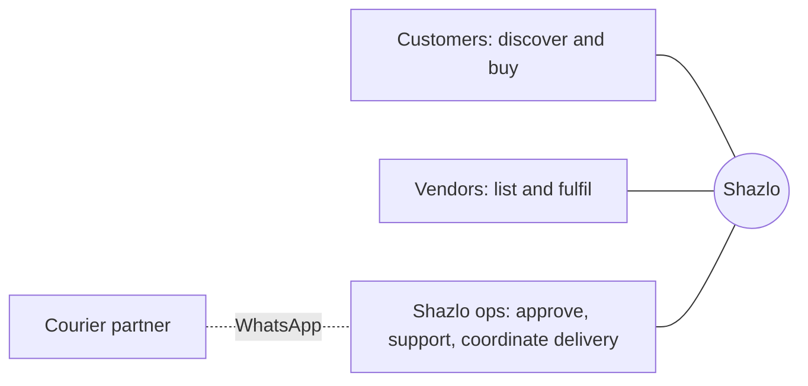

# 01. Personas

| | |
| --- | --- |
| Status | Draft v1.0 for team review. Aligned to `architecture.md` (Core owns commerce; vendor-admin is the seller back-office) |
| Date | 2026-10-20 |
| Owner | To be assigned (product) |
| Inputs | Team meeting transcript, the marketing website (`shazlosite`), the current app and backend, `architecture.md` |

**Legend used in all docs:** `[As-is]` verified in today's code or site, `[Target]` proposed design, `[MVP]` what is built by Oct 30, `[Assumption]` a hypothesis that needs validation.

> Every persona below is a **hypothesis**, built from the meeting transcript and the website, not from interviews. Section 7 lists the research that turns them into facts.

## 1. Who Shazlo serves

Shazlo is a swipe-based fashion discovery app. It launches in **Ahmedabad**, then the rest of **Gujarat** `[As-is: meeting]`. The target customers are **Gen Z and millennials**, and the target vendors are **small and local fashion businesses** `[As-is: meeting]`. Vendors do not pay a listing fee; Shazlo earns a **commission**, decided as **15% flat** for the pilot vendors (the meeting discussed 10 to 20%). Delivery is handled by a **third party** for the first three to four months, coordinated by ops over WhatsApp. At launch customers pay **cash or UPI on delivery**; online payment is built but stays switched off until the payment provider approves Shazlo's account.

The product has three sides, served by two backend services (Core for customers and commerce, the vendor-admin service for the seller side):

| Side | Uses | Backed by |
| --- | --- | --- |
| Customers | The customer app (React Native) | **Core service**: accounts, feed, closets, cart, checkout, orders, stock and payments (the whole buying path) |
| Vendors | The vendor portal (web, phone friendly) | **Vendor-admin service**: vendor accounts, product authoring, order view and fulfilment actions (which it sends to Core), statements |
| Shazlo ops | The admin screens | **Vendor-admin service**: approvals, order operations (sent to Core), audit log |

Each side has its **own login**. A vendor owner who also shops in the app has two accounts, one in each service; this is deliberate (a customer account can never reach vendor or admin data) and is called out where it matters below.

## 2. Priority at a glance

| ID | Persona | Side | Priority for MVP (Oct 30) |
| --- | --- | --- | --- |
| P1 | Aanya, the student shopper | Customer | **Primary** |
| P2 | Riya, the young professional | Customer | Secondary |
| P3 | Kiran, the boutique owner | Vendor | **Primary** |
| P4 | Meera, the catalog assistant | Vendor | Secondary |
| P5 | Ops admin (Shazlo team member) | Internal | **Primary** |
| P6 | Courier partner | External | Supported through WhatsApp only |
| P7 | Investor or press visitor | Website | Website only, no product work |
| P8 | Stylist or creator | Customer / vendor hybrid | Later (the website lists a Creator Programme) |

## 3. Customer personas

### P1. Aanya, the student shopper `[Assumption]`

| | |
| --- | --- |
| Who | 18 to 24, college student in Ahmedabad, lives with family or in a hostel |
| Context | Mid-range Android phone, Instagram and WhatsApp all day, pays with UPI or cash on delivery |
| Budget | Roughly ₹500 to ₹2,500 per item |
| Goals | Find trendy, affordable pieces she would not find by scrolling; save looks to plan outfits; share picks with friends |
| Frustrations | Endless scrolling and filters, not knowing which small brand to trust, sizing risk, delivery that never arrives, being forced to sign up before browsing |
| Jobs to be done | "When I am bored or planning a night out, show me clothes that match my taste in a few swipes so I can save or buy." |
| Success looks like | 30 or more swipes in her first session; saves items to a closet; places a first order within 14 days |
| MVP must-haves | Start as a guest with no sign-up; fast feed with sharp photos; closets she can share by link; an order request she can pay for with cash or UPI on delivery; order status in the app and delivery updates |
| Risks | Slow images on weak networks; distrust of unknown vendors; privacy concerns about collected taste data; a "could not place your order, try again" message if Core is briefly down (checkout does not depend on the vendor back-office, so it keeps working even when that is down) |

### P2. Riya, the young professional `[Assumption]`

| | |
| --- | --- |
| Who | 25 to 34, works in a city office, shops for work and occasion wear |
| Context | Android or iPhone, pays by UPI or card, short on time |
| Goals | Curated options that fit quickly; quality she can rely on; easy returns |
| Frustrations | Poor size and fabric information, returns that are a hassle, too many near-identical choices |
| Jobs to be done | "Help me assemble a few good outfits without hours of browsing." |
| Success looks like | Orders more than once in 60 days; uses closets to plan; filters by price, fabric and product type |
| MVP must-haves | Filters for price, fabric and product type; the vendor's return policy visible on the product; product photos from several angles |
| Risks | Expects online payment and fast delivery; online payment is built but off at launch until the provider approves the account, so the app offers cash or UPI on delivery only |

## 4. Vendor personas

### P3. Kiran, the boutique owner `[Assumption]`

| | |
| --- | --- |
| Who | 26 to 40, runs a small boutique or direct-to-consumer label from Ahmedabad; 10 to 200 products |
| Context | Sells mainly through Instagram and WhatsApp, no developer, limited time for software, does everything from a phone. Signs in to the **vendor portal** with a vendor account (not a customer account) |
| Goals | Reach new customers without paying upfront; get orders that are simple to fulfil; get paid on time |
| Frustrations | High customer acquisition cost, listing fees, complicated seller dashboards, not trusting a platform to settle money fairly |
| What he accepts | A commission on each sale (**15% flat** for pilot vendors, to be confirmed with each vendor in the agreement); delivery by a Shazlo-arranged partner |
| Jobs to be done | "Let me list my products in minutes and get orders on WhatsApp, and only pay when something sells." |
| Success looks like | Registered and approved within two days; first product live in under 10 minutes; first order in two weeks |
| MVP must-haves | Simple application form; approval status he can see; a phone-friendly portal with its own login and an emailed invite after approval; product upload with price, stock, fabric, return policy and several photos; email order notifications with WhatsApp follow-up by ops; 4 business hours to confirm each order; a commission statement |
| Risks | Stock that is out of date; a missed order notification; unclear return rules (7-day window by default); delivery handoff mistakes; a product edit that sends an approved product back to review (title, description or photos) and takes it off the feed until approved again |

Prospect stage: before he is a user, Kiran is a **website visitor** looking for terms (commission, no listing fee, how it works). His application goes to the vendor-admin service. See flow V1 in `02-user-flows.md`.

### P4. Meera, the catalog assistant `[Assumption]`

| | |
| --- | --- |
| Who | Works for a vendor, keeps the product list and stock up to date |
| Context | Laptop or phone, spreadsheets, product photos from a photographer or the owner's phone |
| Goals | Upload many products at once and update stock daily without repeating work |
| Frustrations | Entering one product at a time, rejected uploads with unclear reasons, image size limits |
| Success looks like | A spreadsheet of 50 products imports with errors listed per row, and she fixes only the bad rows |
| Access | A `vendor_staff` account created by the owner; she cannot change the return policy, the team or statements |
| MVP must-haves | Quick stock and price edits; image upload that works on a phone; CSV import with per-row errors (a stretch goal that is cut first if the schedule slips) |

## 5. Internal and external personas

### P5. Ops admin (a Shazlo team member) `[Assumption]`

| | |
| --- | --- |
| Who | A founder or early team member doing operations by hand |
| Context | The admin screens (SQLAdmin in the vendor-admin service, behind Cloudflare Access, with a separate admin account), WhatsApp groups with vendors and the courier partner |
| Goals | Approve good vendors and products quickly, make sure no order is missed, handle returns and refunds, keep support responses fast |
| Frustrations | Manual tracking across chats and sheets, unclear order status, no audit trail |
| Success looks like | Product reviews done within 24 hours; zero orders unconfirmed for more than a few hours; every status change recorded |
| MVP must-haves | Queues for vendor applications and product reviews; an order list with status, one-click status changes and a mark-payment-collected action; WhatsApp message templates (click-to-chat links); an audit log; a view of events that failed to reach the app, with a retry button |

### P6. Courier partner (external actor) `[Assumption]`

A third-party delivery service (not yet named). For the first three to four months ops coordinate with it over WhatsApp and record the result in the admin screens. Later it may become an API integration with tracking webhooks. It is an external actor, not a user of Shazlo software, in the MVP.

### P7. Investor or press visitor `[As-is: website]`

Arrives on the website, wants the story, traction and the deck. The site's only action is a "Request Deck" email to `connect@shazlo.store`. No product work is needed beyond accurate site content.

### P8. Stylist or creator (later) `[As-is: website]`

The website's partnership types include a Creator Programme ("earn on every outfit"). It is not in the MVP and has no data model yet. It is listed so the closet and share features are designed to allow it later.

## 6. Not for now (anti-personas)

- Customers outside Gujarat, and international luxury shoppers.
- Minors under 18 (age and consent handling is an open question).
- Resellers and bots scraping the catalog.
- Large national brands that want an enterprise integration (the current catalog of scraped Zara and M&S items is a demo for discovery, not a vendor relationship).

## 7. Validate before relying on these

Interview **5 to 8 customers** and **5 to 8 vendors** in Ahmedabad in the first two weeks after launch (or this week for vendors, since a signed agreement is pending).

| Question for | What we want to learn | What would change the plan |
| --- | --- | --- |
| Customers | Do they trust cash or UPI on delivery? Which categories do they browse most? How much do they want to pay? | When to switch online payment on; different launch categories |
| Customers | Do swipes feel useful, or do they want search and filters first? | Raise filter work above recommendation work |
| Vendors | Who uploads products: the owner or staff? Phone or laptop? | Mobile-first portal; priority of CSV import |
| Vendors | Is the 15% commission acceptable? What delivery and returns do they already offer? | Commission per vendor; return policy fields |
| Vendors | Do they want orders by WhatsApp, email or the portal? Is a separate vendor login a problem? | Notification channel priority; vendor sign-in design |
| Ops | Where do orders get lost today? | Order status and reminder design |

Open items that affect personas are collected in `open-questions.md` (language: English, Hindi and Gujarati; age limit). Return window (7 days), commission (15%), payment methods at launch and the confirmation window (4 business hours) are decided there.

## 8. Source notes

- Meeting transcript: target customers, launch city, commission, delivery, vendor portal scope, and the priority order.
- Website (`D:\shazlosite\Shazlo`): the partnership types, the Partner tab, the Creator Programme, the `/partner` form (price range slider default ₹2,500 to ₹5,000), the "Request Deck" action.
- Current app: guest start (`/auth/shadow`), closets, swipe gestures, the commented-out cart and profile tabs.
- `architecture.md`: which service each persona uses, separate logins, how orders flow between the two services.
