# 02. User flows

| | |
| --- | --- |
| Status | Draft v1.0 for team review. Flows show which of the **two services** handles each step: **Core** (customer, commerce, money, stock, orders) and the **Vendor-admin service** (seller back-office). See `architecture.md` |
| Date | 2026-10-20 |
| Depends on | `01-personas.md`, `architecture.md` |
| Feeds | `03-system-architecture.md`, `04-database-design.md`, `05-api-design.md` |

**Legend:** `[As-is]` works today (verified in code), `[MVP]` built by Oct 30, `[Target]` after the MVP, `[Assumption]` needs a team decision (see `open-questions.md`).

**Names used everywhere in these docs**

- Roles: `guest`, `customer`, `vendor_owner`, `vendor_staff`, `admin`.
- Vendor status: `applied`, `under_review`, `approved`, `rejected`, `suspended`.
- Product status: `draft`, `pending_review`, `approved`, `rejected`, `archived`.
- Order status: `placed`, `confirmed`, `shipped`, `delivered`, `cancelled`, `return_requested`, `returned`, `refunded`.
- Payment method: `cod`, `upi_on_delivery`, `online`. Payment status: `pending`, `paid`, `failed`, `refunded`.
- Swipe action: `like`, `dislike`, `save`, `cart`, `order`.

## Where the flows run

Shazlo has two backend services. In the diagrams below, **Core** is the customer-facing service that also owns **commerce**: cart, checkout, orders, stock and payments. The **Vendor-admin service** is the seller back-office: vendors, product authoring, fulfilment screens, admin tools, statements.

> **Boundary rule.** Money, stock and order state are changed only by Core. When a vendor or admin acts on an order or on stock, the Vendor-admin service asks Core to do it.

| Group | Runs on | Notes |
| --- | --- | --- |
| Customer flows C1 to C5, C8 | Core only | The Vendor-admin service is not involved |
| C6 place an order, C7 cancel and return | **Core only** (one transaction for checkout) | Core sends events to the Vendor-admin service afterwards |
| C9 notifications | Core (customer push), Vendor-admin (vendor email) | Core pushes at the moment it changes an order; vendor email is triggered by events |
| Vendor flows V1, V2, V4 and admin flows A1, A2 | Vendor-admin only | Product publishing reaches Core by event |
| V3 fulfil an order, A3 order operations | Vendor-admin screens, **Core executes** | The portal calls the Vendor-admin service, which calls Core; the order and stock change in Core |
| State machines S1, S2 | Vendor-admin | Vendor and product status |
| State machines S3, S4 | **Core** | Order and payment status; the Vendor-admin service keeps a read-only copy |

Vendors and admins have **separate accounts and tokens** from customers (`architecture.md` section 8). Someone who is both a shopper and a vendor owner has two logins.

## Index

| Group | Flows |
| --- | --- |
| Customer | C1 first launch, C2 swipe loop, C3 filters and brand explore, C4 closets, C5 account, C6 order, C7 cancel and return, C8 deep links, C9 notifications |
| Vendor | V1 prospect to approved vendor, V2 add products, V3 fulfil an order, V4 returns and commission statement |
| Admin | A1 vendor review, A2 product moderation, A3 order operations, A4 refunds and support |
| Website | W1 visitor funnels |
| State machines | S1 vendor, S2 product, S3 order, S4 payment |

---

## Customer flows

### C1. First launch and guest start `[As-is]`

A new user reaches the feed without signing up. The app creates a **guest** account in the background.

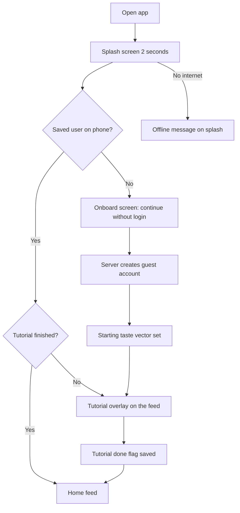

Edge cases:
- Server asleep or failing on guest creation: show a clear message and retry; today the button silently resets.
- Guest data is tied to the phone. If the app is deleted before sign-up, the guest is orphaned (cleaned up by a scheduled job `[Target]`).
- Starting taste vector: today a random product's embedding `[As-is]`; target is a short onboarding set of deliberately different products `[Target]`.

Success metric: share of installs that reach the feed within 10 seconds.

### C2. Swipe loop `[As-is gestures, MVP learning fix]`

Gestures on the top card: swipe **right** = like, **left** = dislike, **down** = save to a closet, **up** = add to cart (currently switched off), tap the left or right half = previous or next photo, the info button flips the card, share sends a link.

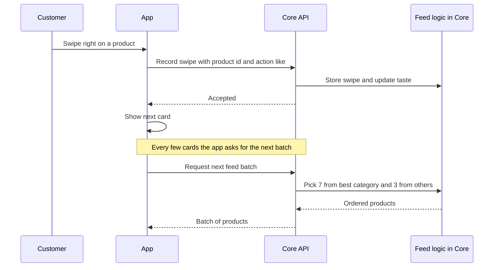

Rules:
- The **server** owns the taste vector. The app sends only the product id, action and dwell time `[MVP]`; today the app also sends vectors and embeddings `[As-is]`.
- Each batch is 10 products: 7 from the user's strongest category and 3 from other categories `[MVP]` (meeting decision).
- Already-seen products are not shown again.
- Only **approved** products with stock appear (read from Core's catalog copy; the stock flag can lag the vendor's edit by a few minutes, and checkout is the final check).

Edge cases: end of deck ("you are all caught up"), no products match filters, fast double swipe (ignore the second until the first finishes), flaky network (queue swipes on the phone and send in a batch `[Target]`).

Success metrics: swipes per session, like rate, save rate, add-to-cart rate.

### C3. Filters and brand explore `[As-is partly, MVP basic filters]`

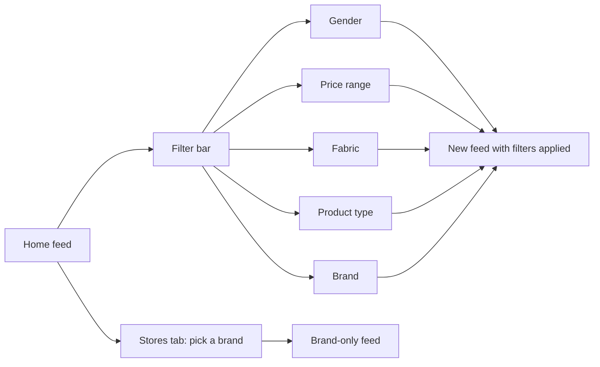

MVP filters: price, fabric, product type (meeting decision), plus gender and brand. Colour and location filters are out of scope for the MVP.

### C4. Closets `[As-is]`

A closet is a named collection of products that can be shared and edited together.

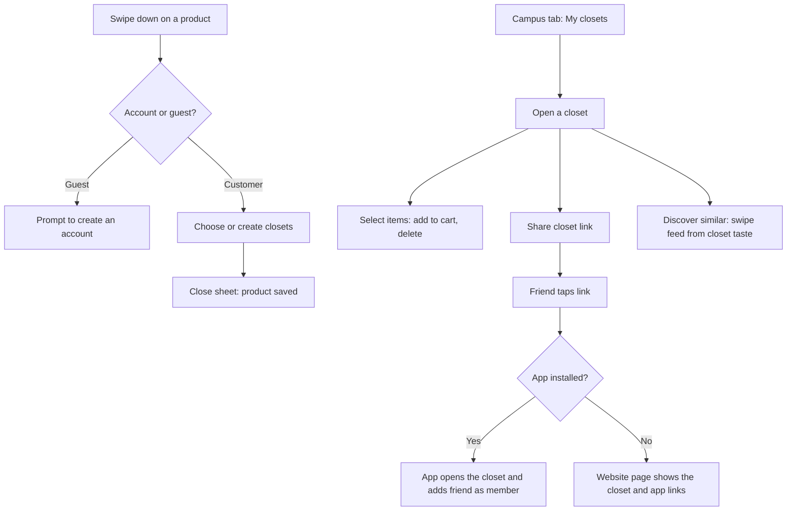

Edge cases: the share link works only if the website serves a landing page (see C8 and `07-website-audit-and-plan.md`); leaving a closet versus deleting it; the last member leaving removes the closet; closet invites should be revocable `[Target]`.

### C5. Account: sign up, log in, log out, delete `[As-is, MVP security fixes]`

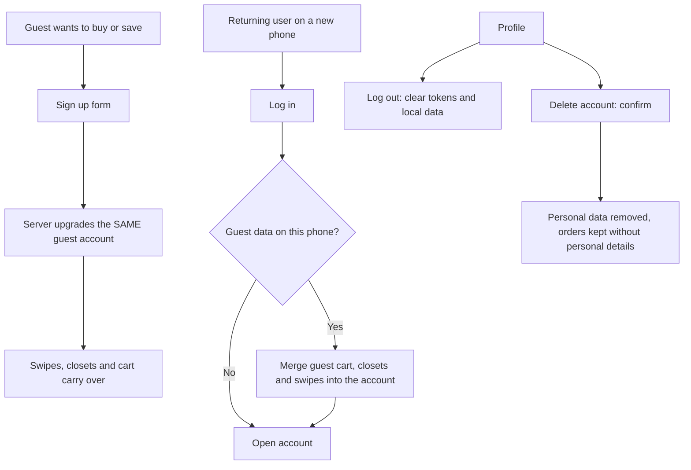

Rules `[MVP]`:
- A guest becomes a customer only with the guest's own session, never by sending someone else's id.
- Sign-up collects name, phone or email, password, and gender. Birth date is optional.
- Google sign-in is optional for the MVP `[Assumption]`.
- These are **customer** accounts in Core. Vendors and admins sign in to the Vendor-admin service (flows V1 and A1), never through the app.
- Deleting an account in Core sends a `customer.deleted` event so the Vendor-admin service blanks personal details on that customer's past orders (money records stay).

### C6. Place an order

**Launch path: order request (cash or UPI on delivery).** Everything the customer needs happens inside Core in one transaction.

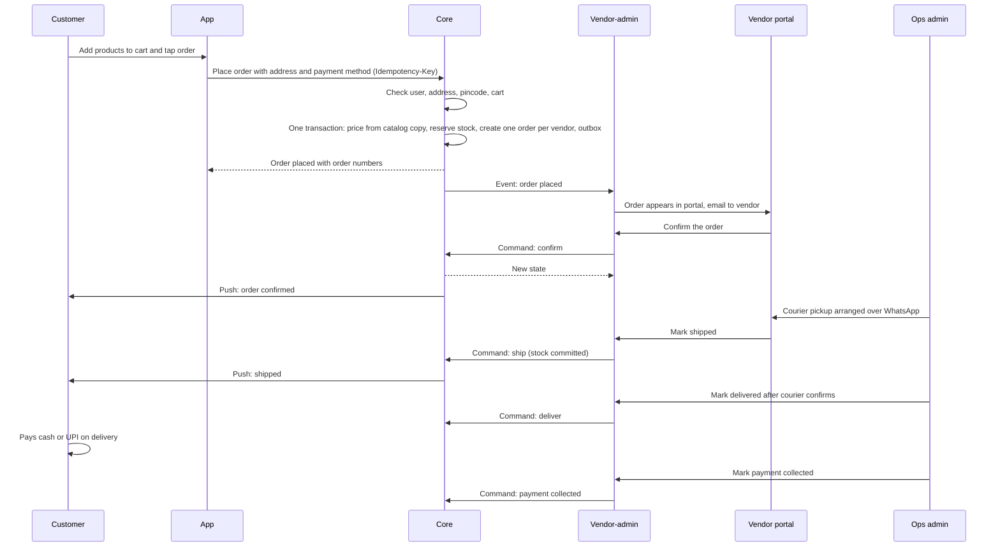

Rules `[MVP]`:
- Payment methods at launch: `cod` or `upi_on_delivery`. The order is `placed` with payment status `pending`.
- **Prices and commission come only from Core's catalog copy** (which the Vendor-admin service publishes) and are snapshotted on the order together with the catalog versions used; the phone cannot change either. The commission is 15% flat for pilot vendors.
- Orders are accepted only for Ahmedabad pincodes at launch `[Assumption]`.
- One cart can hold products from several vendors; Core **splits it into one order per vendor**.
- **Stock is reserved at placement**, atomically, in Core's inventory. Two customers cannot get the last item. A cancel, an auto-cancel or an unpaid timeout releases the reservation; shipping commits it.
- If the Vendor-admin service is down, checkout still works; the order events wait and reach it later.

**Online payment (built behind a switch).** When Razorpay approves the business account and the switch is turned on, the app also offers `online`. **Core** creates the orders with payment `pending`, reserves stock with an expiry and creates the Razorpay order; the customer pays in Razorpay's hosted checkout; a **signed webhook received by Core** marks the orders paid. The Vendor-admin service never touches payments. The vendor can confirm only paid online orders, and unpaid orders are cancelled and their stock released after about 15 minutes `[Assumption]`. Details in `architecture.md` section 6.4.

Edge cases:
- Product sold out between cart and order: the app shows which lines are short and lets the customer remove them.
- Vendor never confirms: reminder email, then Core auto-cancels after 4 business hours, releases stock and notifies the customer.
- Duplicate taps: the idempotency key returns the same orders.
- Address not serviceable; customer cancels before shipping; vendor suspended after the item was added to the cart (the line is rejected with `vendor_not_approved`).
- Price changed a moment ago: the order uses the catalog version Core holds at placement; the app shows the final total before confirming.

Success metrics: order completion rate, time from `placed` to `confirmed`, percentage delivered, checkout error rate.

### C7. Cancel and return `[Assumption]`

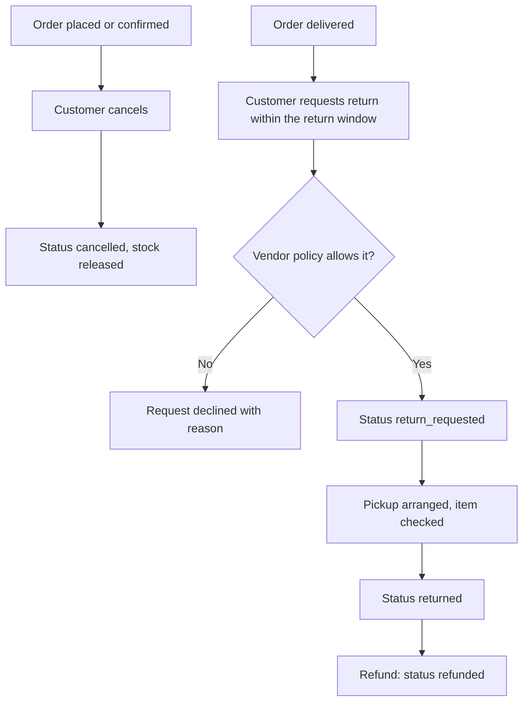

The return window is **7 days** (decided; a vendor policy can shorten it). Who pays return delivery is still open (`open-questions.md`). The vendor's return policy is shown on the product page. A customer cancel is handled directly by Core, which owns the order state machine: if the vendor has already shipped, Core refuses (`not_cancellable`) and the app offers a return later instead. A vendor confirm and a customer cancel can never both succeed: whichever reaches Core first wins. If money was already taken (online), Core creates the refund.

### C8. Deep links and the website fallback `[As-is app, website gap]`

The app opens `https://www.shazlo.store/closet/<id>` and `https://www.shazlo.store/product/<id>`.

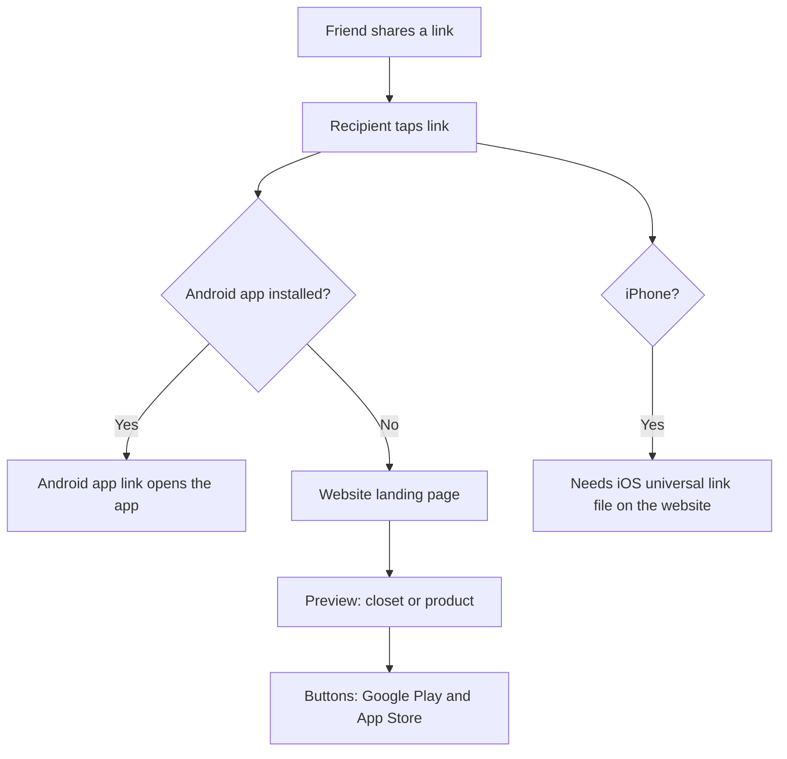

Today the site has Android link verification (`assetlinks.json`) but **no landing pages and no iOS file**, so a link opened without the app shows a blank page. This is a launch blocker for sharing and marketing.

### C9. Notifications `[As-is push registration, MVP orders]`

| Event | Channel | Recipient | Sent by |
| --- | --- | --- | --- |
| Order placed | Push | Customer | Core (from the checkout response) |
| Order confirmed, shipped, delivered, cancelled | Push | Customer | Core, at the moment it changes the order (including when a vendor or admin command arrives) |
| Order status updates | WhatsApp (manual click-to-chat by ops at launch) | Customer | Ops |
| New order, reminder, auto-cancel | Email now, WhatsApp link for ops | Vendor | Vendor-admin service |
| Vendor application received, approved, rejected | Email | Vendor applicant | Vendor-admin service |
| Closet joined by a friend | Push | Closet owner | Core |
| Rewards earned (Shazlo Coins) | In-app | Customer | Core |

Rules: ask for notification permission after the first meaningful action, not at launch; register the device token after login (Core). Customer push is always sent by Core because only Core holds device tokens; the Vendor-admin service never sees them.

---

## Vendor flows

### V1. Prospect to approved vendor `[As-is partly, MVP application API]`

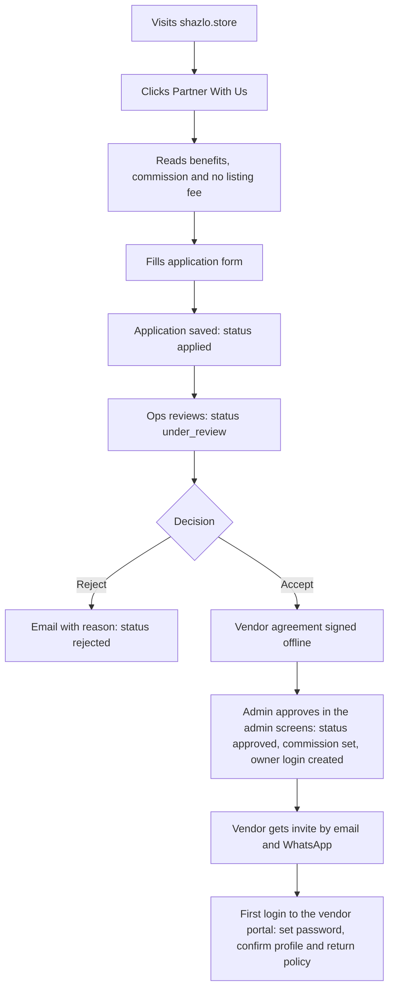

Today the application is a Google Form plus a separate legacy form that posts to a Node and Mongo service; the `[MVP]` replaces both with one form that posts to the **Vendor-admin service** (`vendor-api.shazlo.store`). Everything in this flow happens in the Vendor-admin service: the vendor row, the review, the owner login and the invite.

Application fields: brand name, owner name, phone (WhatsApp), email, city, Instagram or website, product types, price range, about.

Edge cases: duplicate applications (same phone or email), spam (rate limit and challenge), vendor outside Gujarat (waitlist). When a vendor is suspended, the Vendor-admin service publishes an event and Core hides that vendor's products from the feed within minutes; open orders stay with the Vendor-admin service for ops.

Success metric: time from application to approved vendor; share of approved vendors that list a product within 7 days.

### V2. Add products `[MVP]`

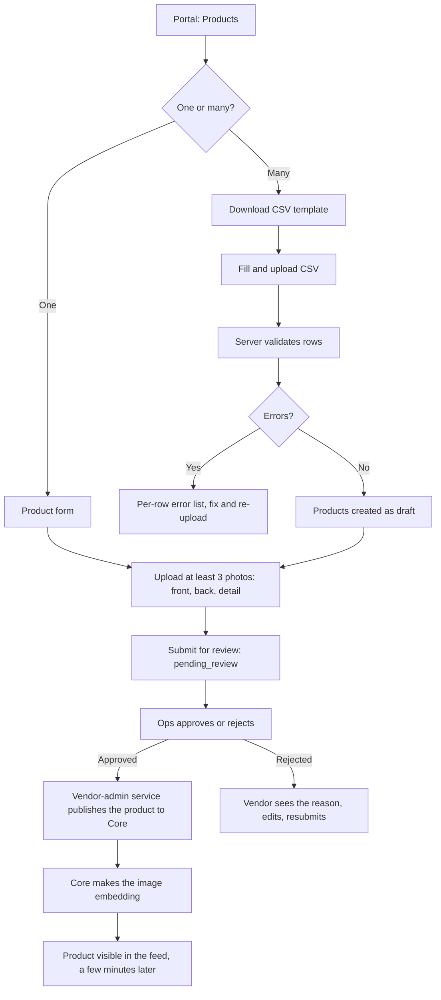

The whole flow runs in the vendor portal against the Vendor-admin service; Core only receives the finished product. Product fields (MVP): title, description, product type, gender, fabric, price, MRP, sizes with stock per size, 3 or more photos, return policy (returnable yes or no and days), weight.

Edge cases: image too large or wrong type; price of zero; negative stock; duplicate title; vendor edits an approved product (**decided:** price and stock apply at once and update the feed copy; title, description and photo changes return it to review and take it off the feed until it is approved again); embedding service down (the product stays approved but hidden, and Core retries).

Success metric: minutes from login to first product submitted; rejection rate.

### V3. Fulfil an order `[MVP]`

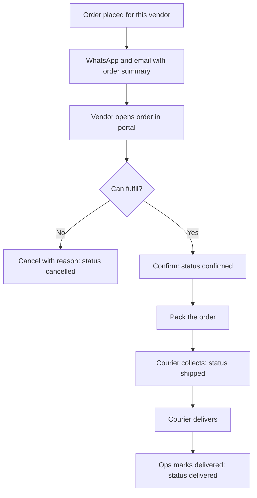

Rules: the vendor must confirm within **4 business hours** (decided); stock was already reserved when the order was placed, and **shipping commits it**; a reminder goes out before auto-cancel (Core emits an overdue event, the Vendor-admin service emails); an unpaid `online` order cannot be confirmed (it waits for the payment webhook handled by Core). **Every status change in this flow is made by Core**: the portal calls the Vendor-admin service, which calls Core, which changes the order and sends the customer's push; the vendor's copy follows by event.

### V4. Returns and commission statement `[Assumption]`

- Return received: vendor inspects, ops marks `returned`, then `refunded`.
- Each order records the **commission rate (15% flat for pilot vendors) and amount at the time of the order**, in Core and copied to the Vendor-admin service. The monthly statement, built in the Vendor-admin service, lists delivered orders, commission and net amount. Settlement is manual in the MVP; payouts are automated after online payments exist.

---

## Admin flows

### A1. Vendor review `[MVP]`
All admin flows run in the Vendor-admin service's admin screens (SQLAdmin at `admin.shazlo.store`, behind Cloudflare Access) with separate admin accounts. Queue of `applied` applications: view details, request more information, reject with reason, or approve (set the commission, create the owner login and invite). Every action is written to the audit log.

### A2. Product moderation `[MVP]`
Queue of `pending_review` products: check photos, price sanity, category and fabric, prohibited items; approve, or reject with a reason template. The product moves to `approved` and is published to Core (it enters the feed once the embedding exists), or to `rejected`.

### A3. Order operations `[MVP]`
List of orders by status (from the Vendor-admin service's copy); highlight orders unconfirmed for too long; send the courier details over WhatsApp using templates; mark delivered, payment collected, cancel or refund (each is a command the Vendor-admin service sends to Core, which changes the order); add notes. Ops also see unpublished or failed events (the outbox view) and can trigger a resync. Target: courier status arrives by webhook.

### A4. Refunds and support `[Assumption]`
Handle returns, issue refunds (manual in the MVP), respond to customer and vendor messages from a shared inbox, and keep a log of decisions.

---

## Website flows

### W1. Visitor funnels `[As-is, with MVP changes]`

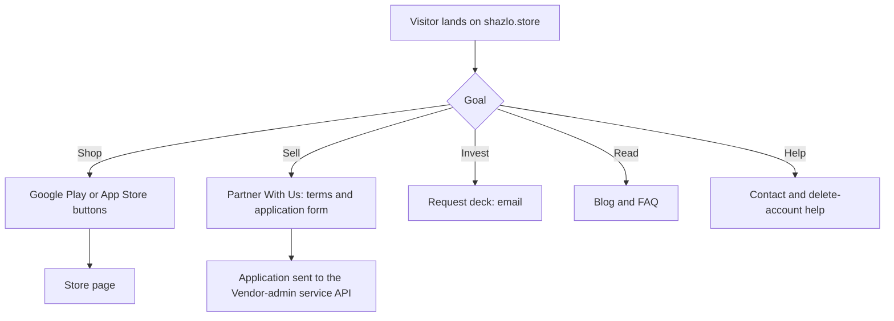

Gaps today: the vendor funnel is a Google Form with no commission message, the contact page is a template with a placeholder phone number and a US address, there is no blog route yet (planned), and the terms and privacy pages are thin. See `07-website-audit-and-plan.md`.

---

## State machines

The **Vendor-admin service owns** S1 (vendor) and S2 (product). **Core owns** S3 (order) and S4 (payment) and is the only service that changes them; the Vendor-admin service keeps a read-only copy so the vendor portal can show it, updated by events and by command responses.

### S1. Vendor
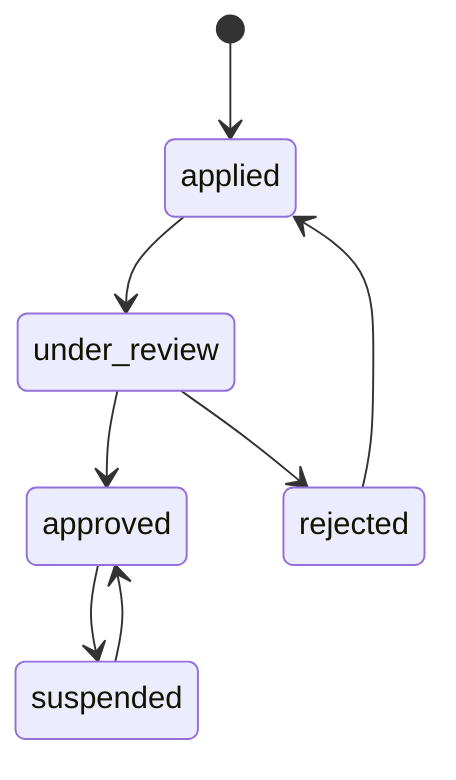

### S2. Product
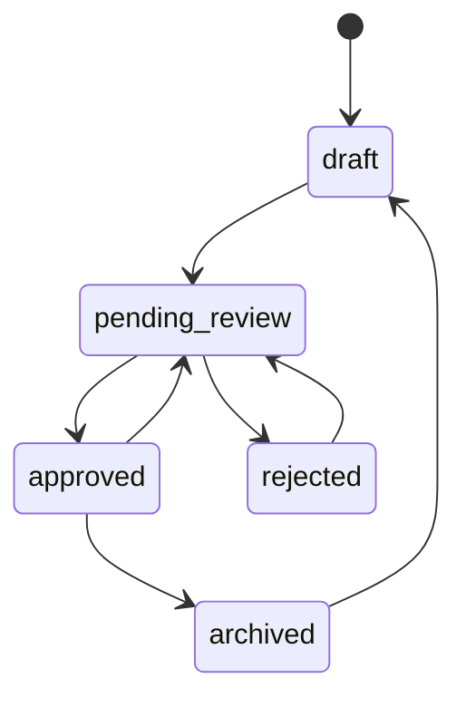

### S3. Order
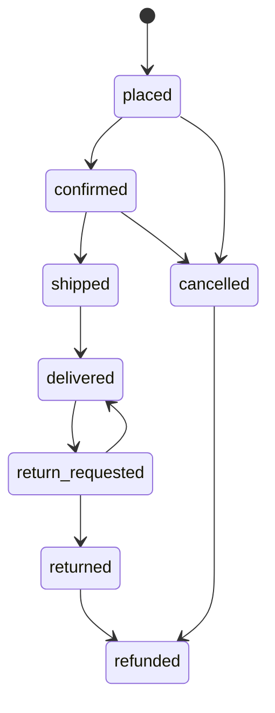

`cancelled` leads to `refunded` only when money was already collected (online payments, behind a switch until Razorpay approves the account).

### S4. Payment
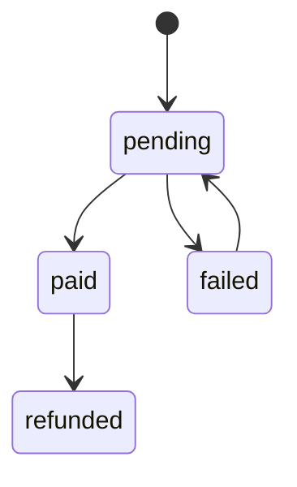

For `cod` and `upi_on_delivery`, payment moves from `pending` to `paid` when ops confirms collection on delivery.

---

## Cross-cutting rules

- **Guest to customer:** same account, never a new one; data stays.
- **Idempotency:** placing an order and recording swipes accept an idempotency key so repeats do nothing.
- **Offline and errors:** every request failure shows a clear state with a retry; no silent failures.
- **Privacy:** an account can always be deleted; personal data in orders is removed while financial records stay.
- **Audit:** every status change is recorded with who and when: order and payment changes in Core (with the vendor or admin id that asked), vendor and product changes in the Vendor-admin service.
- **One owner per rule:** money, stock and order and payment states are decided only by Core; vendors, product authoring, price master, commission settings and statements only by the Vendor-admin service; taste, swipes and ranking only by Core.
- **Copies can lag:** Core's catalog copy (a price or photo edit) and the vendor portal's order copy can be a minute or so behind; money and stock decisions are always made in Core at the moment of the action.
- **Checkout does not depend on the back-office:** it is one Core transaction, so it works while the Vendor-admin service is down. If Core itself fails, no order is created and the customer sees a clear retry message.
