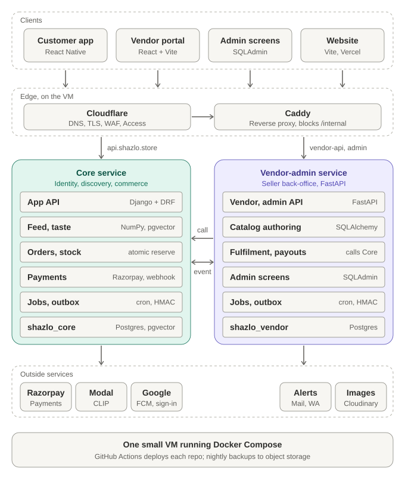
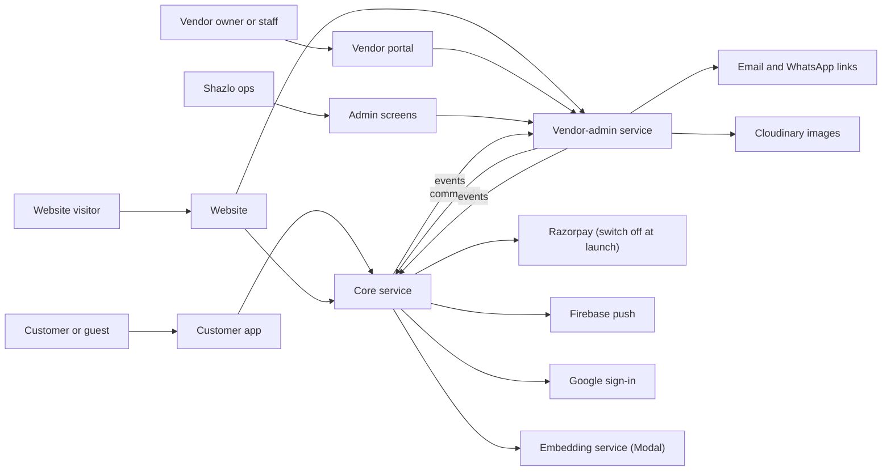
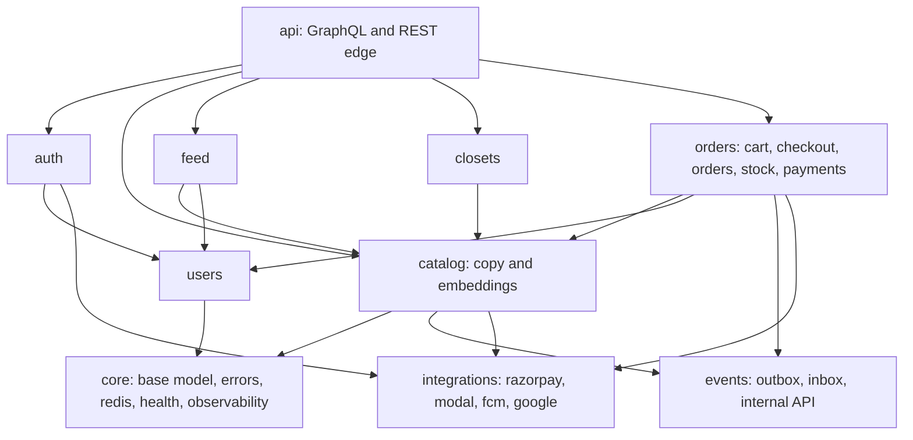
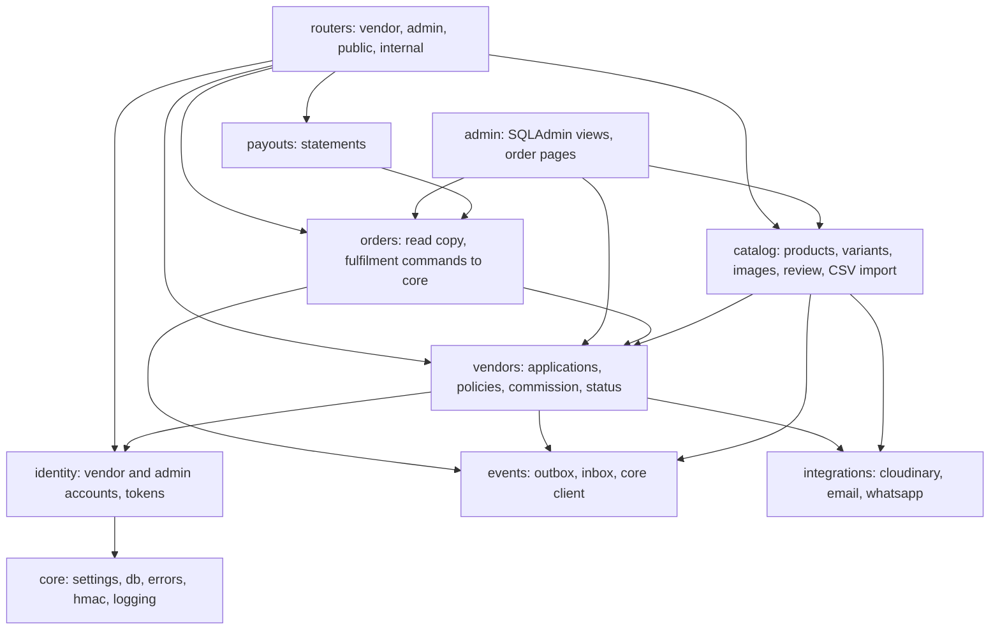

# 03. System architecture (summary)

| | |
| --- | --- |
| Status | Draft v1.0 for team review. **A short companion to `architecture.md`**, which is the authoritative, full architecture document. This summary repeats the picture, the boundaries and the module structure; anything deeper (flows, consistency, security, operations, cost) is in `architecture.md` |
| Date | 2026-10-20 |
| Depends on | `01-personas.md`, `02-user-flows.md`, `architecture.md` |
| Feeds | `04-database-design.md`, `05-api-design.md`, `06-mvp-slice-and-migration.md` |

**Legend:** `[As-is]` verified in today's code, `[Target]` the design (core grows into the `shazlo-server` scaffold), `[MVP]` what runs by Oct 30, `[Assumption]` needs a team decision.

## 1. The system in one page

Shazlo has **four clients** and **two backend services**:

| | Core service (Django) | Vendor-admin service (FastAPI) |
| --- | --- | --- |
| One line | Identity, discovery **and commerce** | Seller back-office |
| Serves | The customer app, the website's previews | The vendor portal, the admin screens, the website's vendor form |
| Owns | Customer accounts, swipes, taste, feed, closets, embeddings, **cart, checkout, orders, stock, payments (Razorpay), refunds, returns** | Vendor applications, vendors, vendor and admin accounts, product authoring and price master, moderation, order read copy, commission settings, statements and payouts, audit |
| Copies it keeps | Published products (`catalog_items`) | Orders (`vendor_orders`) |
| Database | `shazlo_core` (Postgres with pgvector) | `shazlo_vendor` (Postgres) |
| Tokens | Its own, audience `core` | Its own, audience `vendor` |
| Repo | `shaz` (`backend/`) | Portal repo (`backend/`) |

> **The boundary rule `[Decided]`.** Money, stock and order state are changed **only by Core**. The vendor-admin service never takes a payment, never changes a stock count and never owns an order; when a vendor or admin acts on an order or on stock, it sends a signed command to Core.

| Client | Technology | Talks to |
| --- | --- | --- |
| Customer app | React Native | Core (and Razorpay's hosted checkout when payments are on) |
| Vendor portal | React, Vite, TypeScript | Vendor-admin |
| Admin screens | SQLAdmin and portal admin pages | Vendor-admin |
| Website | Vite and React on Vercel | Core (previews, config) and vendor-admin (vendor form) |

## 2. System context

## 3. Containers

The container layout, hostnames, networks and deployment are in `architecture.md` section 10. In short: one VM runs Caddy, the `core` and `vendor` containers, Postgres (two databases) and cron runners; Cloudflare sits in front; the portal and website run on Vercel.

| Container | Responsibility | Status |
| --- | --- | --- |
| `core` web | Customer API (REST now, GraphQL target), checkout, orders, stock, Razorpay webhook, public previews, internal receiver | `[As-is]` hardened and extended |
| `vendor` web | Vendor and admin APIs, vendor application, SQLAdmin, internal receiver | `[MVP]` new |
| `postgres` | `shazlo_core` (pgvector) and `shazlo_vendor` | `[As-is]` Postgres |
| `caddy` | Hostname routing; returns 404 for `/internal/*` publicly | `[MVP]` |
| cron runners | Per service: timers, embeddings, event delivery, reconciliation | `[MVP]`; worker with Redis `[Target]` |

## 4. Modules

### 4.1 Core service `[Target]`

| Module | Owns | Key operations |
| --- | --- | --- |
| `users` | User, profile, addresses, devices | `user_create`, `user_update`, `user_deactivate` |
| `auth` | Tokens, guest start, sign-up upgrade, login, Google | Issue and verify tokens |
| `catalog` | `catalog_items`, embeddings, scraped items | `catalog_upsert_from_event`, `embedding_store` |
| `feed` | Swipes, taste, slate (7 plus 3), rewards | `feed_next`, `swipes_record`, `feed_refill` |
| `closets` | Closets, members, invites | `closet_create`, `closet_join`, `closet_add_item` |
| `orders` | Cart, inventory, reservations, orders, status events, payments, refunds, deliveries, returns | `cart_add`, `checkout_place`, `order_confirm`, `order_ship`, `order_cancel`, `payment_capture`, `inventory_set`, `stock_expire` |
| `events` | Outbox, inbox, idempotency keys, command and event receivers | `outbox_publish`, `inbox_receive` |
| `integrations` | Thin clients | One function per outside call |

### 4.2 Vendor-admin service `[MVP]`

| Module | Owns | Key operations |
| --- | --- | --- |
| `identity` | `vendor_users`, `admin_users`, refresh tokens | Login, refresh, invite, password reset |
| `vendors` | Vendors, policies, locations, commission history | Apply, approve, reject, suspend, set commission |
| `catalog` | Categories, products, variants, images, import jobs | Create draft, submit, approve, reject, archive, import CSV |
| `orders` | `vendor_orders` copy; the **client** that sends commands to core | `order_confirm`, `order_ship`, `order_cancel`, `stock_set` (all call Core) |
| `payouts` | Payouts and lines | Monthly statement |
| `events` | Outbox, inbox | `outbox_publish`, `inbox_receive` |
| `admin` | SQLAdmin model views, admin order pages | Approve, reject, mark delivered, retry event |

### 4.3 Rules (both services)

1. Calls go downward: router or controller, then service or query, then model, store or integration.
2. A module calls another module's **services**, never its queries, stores or models for writing.
3. Expected errors are `ApplicationError(message, extra)`; everything else is a 500 that is reported.
4. Pure maths (feed mix, taste update, commission, state machines, CSV validation) has no framework imports.
5. Boundaries are enforced with import-linter in CI.
6. **Between the services:** no shared database; commands over the internal API, facts as events; copies are read-only and versioned; money, stock and order state change only in Core.

File roles: Django modules use `graphql.py`/`apis.py`/`webhooks.py`, `services.py`, `selectors.py`, `store.py`, `tasks.py`, `models.py`; FastAPI modules use `routers.py`, `schemas.py`, `services.py`, `queries.py`, `models.py`, `deps.py`.

## 5. Key flows

Sequence diagrams for publishing a product, checkout (cash or UPI on delivery), online payment, fulfilment, cancel and return, statements and account deletion are in `architecture.md` section 6. The user-facing versions are in `02-user-flows.md`.

## 6. Roles and permissions

| Capability | guest | customer | vendor_staff | vendor_owner | admin |
| --- | --- | --- | --- | --- | --- |
| Enforced by | core | core | vendor-admin | vendor-admin | vendor-admin |
| Browse feed, swipe | yes | yes | no | no | no |
| Closets, cart | limited (prompt to sign up) | yes | no | no | no |
| Place an order | no | yes | no | no | no |
| Manage own products | no | no | yes | yes | yes |
| Set stock, confirm and ship own orders | no | no | yes (through Core) | yes (through Core) | yes (through Core) |
| Manage vendor profile, team, statements | no | no | no | yes | yes |
| Approve vendors and products, mark delivered or collected, refund | no | no | no | no | yes (order actions through Core) |
| See another vendor's data | no | no | no | no | yes |

Every route requires a token unless it is on a short public list; permissions are checked on the **object**; a failed object check returns "not found". The roles are separate accounts in separate services: an admin who also shops uses a customer account.

## 7. Security, observability and operations

Authentication, the threat model, PCI scope (hosted Razorpay checkout), DPDP handling, service levels, backups, failure modes, alerts and runbooks are in `architecture.md` sections 8 and 9. Key points: separate token issuers and audiences; HMAC-signed internal calls on the Docker network only; payment credentials exist only in Core; one `request_id` follows a request across both services; nightly backups with a weekly restore test.

## 8. Vendor portal and admin

| | MVP | Target |
| --- | --- | --- |
| Portal UI | React single-page app (`frontend/` in the portal repo) at `seller.shazlo.store`, calling the vendor-admin API | Same, plus real-time order status and courier events |
| Admin data screens | SQLAdmin at `admin.shazlo.store` behind Cloudflare Access (vendors, products, users, audit) | A purpose-built ops screen |
| Admin order operations | Portal admin pages calling the vendor-admin API, which sends commands to Core | Same, plus courier webhooks |
| Images | Direct upload to Cloudinary, three or more per product | Presigned upload to object storage with automatic sizes |

The website's prototype screens (`seller.*`, `crm.*`) are retired and replaced by the portal.

## 9. Website and domains

| Domain | Purpose |
| --- | --- |
| `www.shazlo.store`, `shazlo.store` | Marketing site (Vercel); deep-link landing pages, iOS link file, vendor funnel |
| `api.shazlo.store` | Core service |
| `vendor-api.shazlo.store` | Vendor-admin API |
| `seller.shazlo.store` | Vendor portal (Vercel) |
| `admin.shazlo.store` | Admin screens, restricted by Cloudflare Access |
| `images.shazlo.store` (later) | Image CDN |

The website's vendor form posts to the vendor-admin service (replacing the Google Form and the legacy Node and Mongo service on Render, which is then shut down); `/closet/:id` and `/product/:id` previews use core's public endpoints. Details in `07-website-audit-and-plan.md`.

## 10. MVP slice versus target

| Capability | MVP (Oct 30) | Target |
| --- | --- | --- |
| App API (core) | REST (existing routes plus the commerce and public routes in `05`) | GraphQL |
| Vendor, admin APIs | FastAPI vendor-admin service, React portal, SQLAdmin | Same plus ops screens |
| Checkout and stock | Core transaction with atomic reservation | Same, with expiry sweeps tuned |
| Payments | Cash and UPI on delivery; Razorpay built in core behind a switch (off) | Online payments live, courier webhooks |
| Feed | Fixed weights, cosine ranking, 7 plus 3 slate | pgvector HNSW, precomputed queues |
| Background work | Cron commands in each service | Worker with Redis |
| Images | Cloudinary direct | Object storage and CDN |
| Hosting | One small VM with Docker Compose, Cloudflare in front | Managed Postgres, second VM |

## 11. Related documents

`architecture.md` (full), `01` to `08`, `adr/`, `open-questions.md`.
