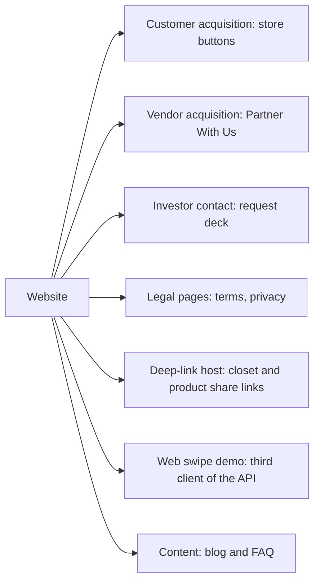
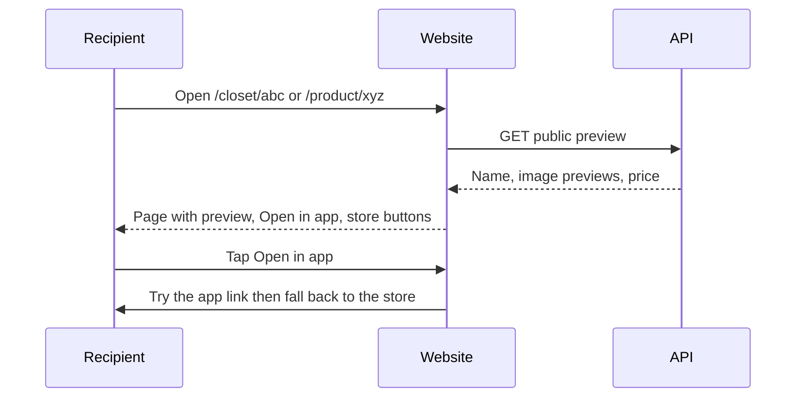

# 07. Website audit and plan

| | |
| --- | --- |
| Status | Draft v0.1 for team review |
| Date | 2026-10-19 |
| Scope | The marketing website in `D:\shazlosite\Shazlo` (repository `naby001/Shazlo`) |
| Method | Read-only review of the source. Nothing was checked on the live site, in Vercel or in Cloudflare (see section 9) |

**Legend:** `[As-is]` found in the source, `[MVP]` needed by Oct 30, `[Target]` after launch, `[Assumption]` needs a decision.

## 1. What the site is `[As-is]`

| Item | Finding |
| --- | --- |
| Stack | Vite 7, React 19, `react-router-dom` 7 (client-side routes, no server rendering), Material UI, framer-motion, plus three.js and Spline libraries; JavaScript only; Vercel hosting (`vercel.json` has one rewrite of every path to `/`) |
| Repositories | `Shazlo/` is the website repo. Inside it, `app/` is the site and `backend/` is a small **legacy Node, Express and Mongo service** for waitlist and brand registration (deployed on Render). The outer `D:\shazlosite` folder holds an extra empty git repo and can be ignored |
| Live page | `Home_v2` (hero, about, how it works, features, team, partner, investors, footer). About 45 other components are legacy |
| Routes | `/`, `/home_v2`, `/swipe` (web swipe demo), `/alternate_home`, `/waitlist`, `/privacy`, `/terms-of-service`, `/contact`, `/faq`, `/partner`. Hostname-based screens for `seller.*` and `crm.*` also exist |
| Contact | `connect@shazlo.store`, Instagram, LinkedIn |
| Team shown | Pranav Deora (Founder and CEO), Darsh Modi (Marketing Co-Founder), Nabyendu Das (Tech Co-Founder) |
| App links | Google Play (`com.shazlo.mobile`) and the App Store (id `6756888889`) |

## 2. The roles the site plays in the system

The app already sends users to `https://www.shazlo.store/closet/<id>`, `/product/<id>`, `/terms-of-service` and `/privacy`. The site must therefore be treated as part of the product, not a brochure.

## 3. Findings and priorities

### P0: fix before launch `[MVP]`

| # | Finding | Why it matters | Fix | Effort |
| --- | --- | --- | --- | --- |
| W1 | **No pages for shared links.** `/closet/:id` and `/product/:id` match no route (blank page). `assetlinks.json` exists for Android only; there is **no iOS** `apple-app-site-association` file | Sharing and marketing links fail for anyone without the app and for all iPhones | Landing pages that call the public preview endpoints and show store buttons; add the iOS file; keep `/.well-known` outside the single-page rewrite (section 5) | 1 day |
| W2 | **Secrets and large files committed.** `app/.env`, `app/.env.production` and `backend/.env` are tracked (names include a Mongo connection string and a JWT secret); `backend/node_modules` (3,325 files), a 66 MB APK and a 104 MB 3D file are in the repo | Exposed credentials; slow clones | Rotate every value that was committed; remove the files from tracking; add ignore rules; decide whether to rewrite history | 0.5 day |
| W3 | **Vendor funnel is thin.** A Google Form iframe plus a second `/partner` form that posts to the legacy service; no link from the home page to `/partner`; no commission or "no listing fee" message; the second form shows success even when the request fails; no spam protection | Vendors are the supply side of the MVP | One application form that posts to `POST /public/vendor-applications`, clear terms, success and failure states, spam protection, a link from the home page (section 5.3) | 1 day |
| W4 | **Legal pages are generic and inconsistent.** Mail links point to `shazapp.com` while the visible text says `shazlo.store`; "Last updated" is today's date at render time; no vendor terms, delivery, returns, payments, data sharing, retention, grievance contact or Digital Personal Data Protection Act language | Legal and trust risk when real vendors and customers sign up | Rewrite with counsel; fixed dates and a version; add vendor terms and a return and shipping policy | Counsel plus 0.5 day |
| W5 | **Unprotected prototype screens.** `seller.*` and `crm.*` routes load a seller dashboard, a CRM panel and an admin portal with hard-coded local addresses and no authentication; the legacy service has open admin routes and open CORS | Anyone reaching those hostnames could use them | Remove these routes and screens from the site; the vendor portal is built in the backend project; shut down the legacy service after migrating its data | 0.5 day |
| W6 | **Contact page is a template** (placeholder phone number, a US address, a form that posts nowhere) | Looks unfinished; wrong details | Replace with the real contact details or remove the page | 0.25 day |

### P1: fix in the launch week `[MVP]` or soon after

| # | Finding | Fix |
| --- | --- | --- |
| W7 | **SEO and sharing basics are missing:** no meta description, Open Graph or Twitter tags, canonical link, `robots.txt`, `sitemap.xml`; one fixed page title; the favicon is declared with the wrong type; unknown paths show a blank page (no 404) | Add per-route titles and tags, a 404 page, `robots.txt`, `sitemap.xml` and an Organization schema |
| W8 | **Performance:** images of 2 MB to 11 MB used as plain images, three.js and Spline code in the bundle, all legacy pages in one bundle | Compress and resize images, drop unused 3D code, split routes, serve modern image formats |
| W9 | **Inconsistent story:** the home page says swiping up opens the brand's website, the FAQ promises in-app purchase later, and the plan is delivery through a partner; Ahmedabad, Gen Z and millennials are never mentioned; "Free, Always" is an unqualified claim | One agreed commerce message; add the launch city; review claims with the team |
| W10 | **Fonts:** the heading font (Bodoni Moda) is not loaded, so it falls back; a local font (Garbata Trial) is licensed for non-commercial use | Load the font properly; replace or license the other |
| W11 | **Blog:** none exists; the meeting asked for one | Add `/blog` (section 6) |
| W12 | **Accessibility:** three accessibility attributes in the live components, thin alt text, no skip link | Add labels, alt text and keyboard checks |
| W13 | **Analytics and consent:** Google Analytics and Vercel Analytics, no consent notice, no events for key buttons | Add a consent notice and events for store buttons, Partner With Us and the application form |

### P2: clean-up `[Target]`

- Remove the 45 legacy components, the unused Redux persistence, and unused packages (the front end lists server libraries such as `multer` and `cloudinary`).
- Move to TypeScript, add linting in CI and Vercel preview deploys, and run a dependency audit.
- Rework the web swipe demo to use the token-based API (it currently calls the live API with no token) and cap how long it can run.
- Replace the legacy Node service entirely (section 5.4).

## 4. How the site integrates with the system

| Site feature | API used | Doc reference |
| --- | --- | --- |
| Vendor application form | `POST vendor-api.shazlo.store/api/v1/public/vendor-applications` (vendor-admin service) | `05-api-design.md` section 4 |
| Closet landing page | `GET /public/closet-invites/{token}` (target); `GET /public/closets/{id}` (MVP, id based) | `05` section 4; `06` section 4 |
| Product landing page | `GET /public/products/{id}` | `05` section 4 |
| Contact form | `POST /public/contact` | `05` section 4 |
| Web swipe demo | The app API (guest start, feed, swipes) | `05` sections 3 and 10 |
| App version and flags | `GET /public/config` | `05` section 4 |

Environment and security: the site's API base address comes from one environment variable (`VITE_API_URL`) pointing at `https://api.shazlo.store`; the backend's CORS allow-list contains the site's origin only; no API keys live in the browser.

## 5. Designs `[MVP]`

### 5.1 Deep-link landing pages

Rules:
- Each page works with no login and no app.
- A missing, revoked or unapproved target shows a friendly "not found" page.
- Open Graph tags on these pages use the preview so chat apps show a card.
- Android: keep `/.well-known/assetlinks.json` (package `com.shazlo.mobile`) served as JSON with no redirect.
- iOS: add `/.well-known/apple-app-site-association` (JSON, no file extension, no redirect) listing the app's id `<Apple team id>.<bundle id>` and the paths `/closet/*` and `/product/*`; also set the smart app banner meta tag `[Assumption: the Apple team id and bundle id must be supplied by the owner of the Apple account]`.
- Vercel: static files in `public/` are served before the rewrite, but check the live response headers for both `.well-known` files after deploy.

### 5.2 Routes to add or change

| Route | Purpose |
| --- | --- |
| `/closet/:id` | Closet preview (MVP: closet id; target: share token) |
| `/product/:id` | Product preview |
| `/for-brands` | Vendor landing page: benefits, how it works, terms summary, FAQ, apply button |
| `/for-brands/apply` | The application form |
| `/blog`, `/blog/:slug` | Blog |
| `/faq` | Customer and vendor FAQ |
| `/vendor-terms`, `/returns-policy`, `/shipping-policy` | New legal pages |
| `*` | 404 page |

### 5.3 Vendor application form

Fields: brand name, owner name, WhatsApp phone, email, city, Instagram or website, product types, price range, about. Validation in the browser and on the server. Spam protection: a hidden honeypot field plus a bot-check token (Cloudflare Turnstile) `[Assumption]`. On success: a confirmation with what happens next (review within two working days `[Assumption]`) and an email. On failure: an error message and the form stays filled. Do not publish the commission percentage until the team settles it (`open-questions.md`); say "no listing fee, you pay only when you sell".

### 5.4 Retire the legacy Node and Mongo service

1. Export pending brand registrations and waitlist users from Mongo.
2. Import brand registrations as vendors with status `applied` (a one-off script against the new application endpoint or the database).
3. Keep waitlist emails only if there is consent to contact them.
4. Switch the site's forms to the Shazlo API, then shut down the Render service and delete its database and environment files.

### 5.5 Home page and content changes

- Hero: keep "Swipe to Style"; add the launch city and the audience.
- "How it works": state exactly what swipe up and swipe down do in the shipped app.
- Partner section: link to `/for-brands`; replace the Google Form.
- Replace "Free, Always" with a precise statement.
- Footer: consistent contact address; links to all legal pages.

## 6. Blog `[Target, decision needed]`

The site is a single-page app, so blog posts are not visible to search engines or link previews unless pages are pre-rendered. Options:

| Option | Effort | SEO | Note |
| --- | --- | --- | --- |
| Markdown files in the repo, built into pages at build time (static pre-rendering plugin) | Medium | Good | Fits the current stack; editing needs a pull request |
| Move the whole site to a framework with static output (Astro or Next.js) | Larger | Best | A rebuild of the site; better long-term home for blog, landing pages and previews |
| Hosted CMS with pre-rendering | Medium | Good | Easiest for the marketing owner; adds a vendor |

Recommendation `[Assumption]`: start with Markdown plus pre-rendering so the blog can launch with the meeting's plan; revisit a framework move after launch.

## 7. Work plan

| When | Items | Owner (suggested) |
| --- | --- | --- |
| Oct 19 to 21 | W2 secrets rotation and cleanup; W5 remove prototype routes; W6 contact page | Website owner |
| Oct 21 to 23 | W1 landing pages and link files (needs the public preview endpoints from the backend track); W3 form and `/for-brands` | Website owner with backend track |
| Oct 23 to 27 | W4 legal pages (counsel review in parallel); W7 SEO; W9 content decisions | Website owner, marketing, counsel |
| Oct 27 to 30 | W8 performance; W10 fonts; W12 accessibility; W13 analytics and consent | Website owner |
| After launch | Blog (W11); P2 clean-up; framework decision | Website owner, marketing |

Dependencies: W1 and W3 need `GET /public/products/{id}`, `GET /public/closets/{id}` and `POST /public/vendor-applications` from the MVP backend (`06` section 4). W4 needs the commission, return window and delivery decisions from the team.

## 8. Verification checklist (do these on the live site)

- [ ] `https://www.shazlo.store/.well-known/assetlinks.json` returns the JSON with the right content type and no redirect; the iOS file does too.
- [ ] A shared closet and product link opens the right page on a phone with and without the app, on Android and iPhone.
- [ ] Pasting a link into WhatsApp shows a preview card.
- [ ] The vendor form creates an application the admin can see, and a failed request shows an error.
- [ ] No `.env` file, key or connection string is tracked in git (`git ls-files` and a history scan), and old values have been rotated.
- [ ] `seller.` and `crm.` hostnames no longer serve prototype screens.
- [ ] All legal pages show the same contact address and a fixed date.
- [ ] A performance and accessibility check passes agreed thresholds `[Assumption]`.

## 9. What was not verified

The live site, Vercel project settings and domains, Cloudflare configuration, analytics property ownership, whether the APK in `public/` is linked anywhere, and the contents of the Google Form. Environment variable **names** were read; values were not.

## 10. Evidence

Files reviewed in `D:\shazlosite\Shazlo`: `app/src/App.jsx` (routes and hostname switch), `app/src/Home_v2.jsx` and `app/src/v2_components/*`, `app/src/components/partner.jsx`, `app/public/.well-known/assetlinks.json`, `app/vercel.json`, `app/index.html`, `app/src/services/api.js`, `app/src/api/*`, `backend/server.js`, `backend/models/*`, `backend/routes/*`, and the git history (117 commits, 2025-07-09 to 2026-10-04).
