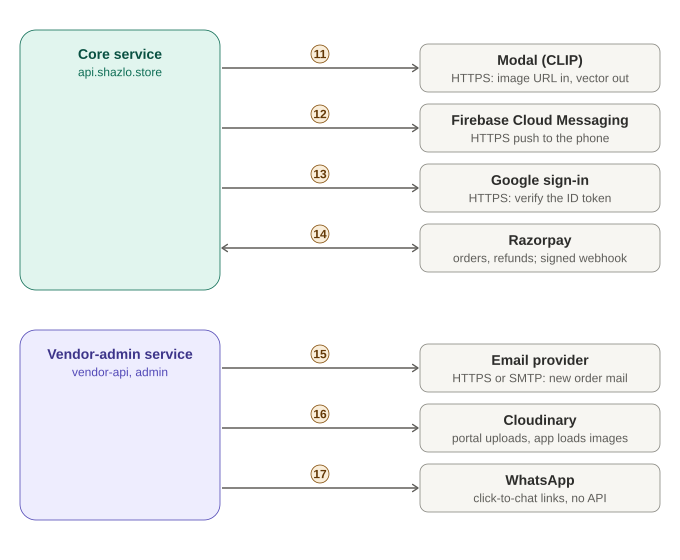
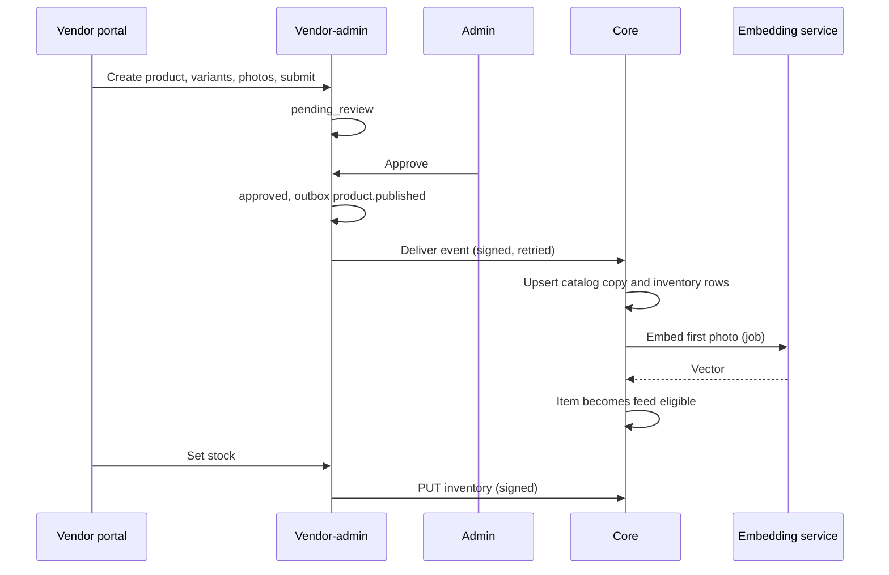
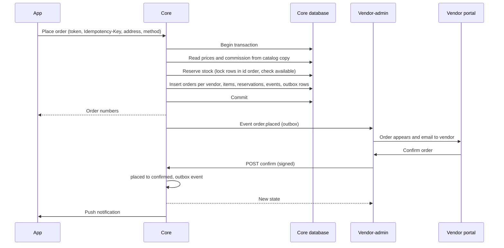
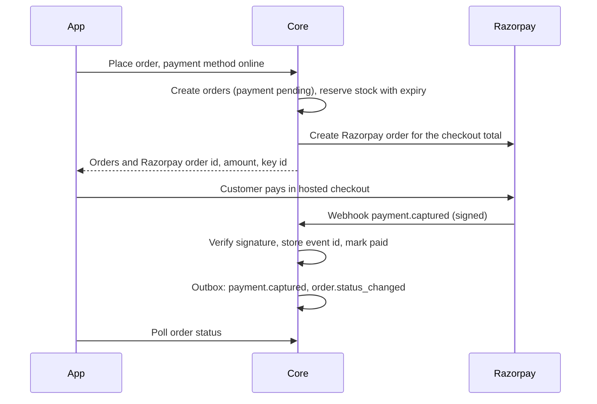
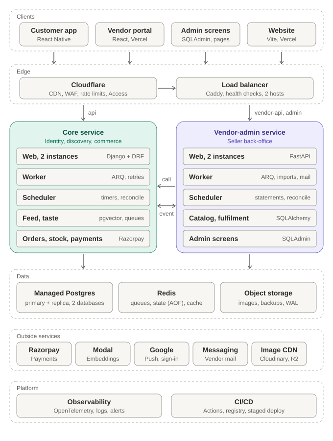

# Shazlo architecture

| | |
| --- | --- |
| Status | Draft v1.0 for team review. **This is the authoritative architecture document.** Documents `01` to `08` and the ADRs are aligned to it; if they disagree, this document wins until they are fixed |
| Date | 2026-10-20 |
| Audience | The three engineers, the founders and ops, anyone joining |
| Supersedes | The earlier two-service draft in which orders and payments lived in the vendor-side service (`08` v0.3, ADR 0007 as first written) |

**Legend.** `[Decided]` agreed by the team. `[Assumption]` a proposal that needs confirmation (listed in section 15). `[As-is]` true in today's code. `[MVP]` built by the Oct 30 freeze. `[Target]` after the MVP.

## 1. Purpose, scope and constraints

### 1.1 Purpose
Describe how Shazlo is built, where each technology is used and why, how the parts talk, and how the system is run safely in production. It is meant to be read top to bottom once, then used as a reference.

### 1.2 What Shazlo is
A swipe-based fashion discovery and shopping app for Gen Z and millennials, launching in Ahmedabad, then Gujarat. Local fashion vendors list products; customers swipe, save to shared closets, and order; Shazlo takes a commission and coordinates delivery by a third party.

### 1.3 Goals
1. Customers can discover, order and track products safely, with prices and stock that are always right.
2. Vendors can apply, list products, and fulfil orders from a phone-friendly portal.
3. Ops can approve vendors and products, run orders, and see what went wrong.
4. The system is secure enough to take real money, observable enough to be run by three people, and cheap enough for a startup.
5. It grows from hundreds of daily users to about 10,000 daily users and 20,000 products without a rewrite.

### 1.4 Non-goals (for now)
Native iOS-only features, multi-city logistics, an agentic salesperson, vendor staff roles beyond owner and staff, automatic vendor payouts, a mobile app for vendors, multi-currency, marketplaces outside India.

### 1.5 Constraints
| Constraint | Value |
| --- | --- |
| Team | 3 engineers; tracks to be named |
| Deadline | Code freeze Oct 30, buffer to Nov 2 |
| Budget | As low as practical: one small VM, free tiers where allowed |
| Payments | Razorpay account **not yet approved**; launch path is cash or UPI on delivery |
| Existing code | A Django backend with known security and logic bugs; a React Native app; a Vite website; a half-built `shazlo-server` scaffold |
| Scale target | Launch plus six months: hundreds, growing to about 10,000 daily users and 20,000 products |

## 2. Architecture overview

### 2.1 Shape: two services, one rule
Shazlo is **two backend services** and four clients.

- **Core service (Django)**: *identity, discovery and commerce*. It serves the customer app and owns the customer's whole buying path: accounts, feed and taste, closets, **cart, checkout, orders, stock, payments (Razorpay), refunds and returns**.
- **Vendor-admin service (FastAPI)**: the *seller back-office*. It serves the vendor portal and the admin screens and owns everything about the supply side: vendor onboarding, catalog authoring and moderation, fulfilment screens, commission settings, statements and payouts, audit.

> **The boundary rule `[Decided]`.** Money, stock and order state are changed **only by Core**. The vendor-admin service never takes a payment, never changes a stock count itself, and never owns an order; when a vendor or admin acts on an order or stock, the vendor-admin service asks Core to do it.

Why this boundary: checkout and payments are part of the customer's buying path, so they live next to the customer, with one transaction boundary around "place order, reserve stock, take payment". The back-office can be down for an hour and customers can still browse, order and pay.

### 2.2 Clients
| Client | Technology | Talks to |
| --- | --- | --- |
| Customer app | React Native 0.80 (Android, iOS built) | Core only (plus Razorpay's hosted checkout when payments are on) |
| Vendor portal | React, Vite, TypeScript (portal repo `frontend/`), Vercel | Vendor-admin service only |
| Admin screens | SQLAdmin (data screens) and portal admin pages (order operations) | Vendor-admin service only |
| Website | Vite 7, React 19, Vercel | Core (previews, config) and vendor-admin (vendor application form) |

### 2.3 Ownership matrix
| Capability | Core | Vendor-admin |
| --- | --- | --- |
| Customer and guest accounts, login, tokens, devices | owns | |
| Swipes, taste vector, feed, closets | owns | |
| Embeddings and vector search | owns | |
| Scraped link-out products | owns | |
| **Cart, checkout, orders, order state machine** | **owns** | reads a copy |
| **Stock counters and reservations** | **owns** | edits through Core |
| **Payments, refunds, Razorpay, webhooks** | **owns** | never |
| Returns | owns | decides vendor side through Core |
| Customer notifications (push) | owns | |
| Vendor applications, vendors, vendor and admin accounts | | owns |
| Products, variants, price master, photos, categories, moderation | | owns |
| Catalog copy for the feed (price, photos, commission rate) | owns (read only, from events) | publishes |
| Commission settings | reads a copy | owns |
| Vendor order view | | owns a read copy (from events) |
| Fulfilment actions (confirm, ship, cancel, deliver) | executes | requests |
| Statements and payout records | | owns (computed from order events) |
| Vendor notifications (email, WhatsApp links) | | sends |
| Admin audit log of back-office actions | own actions | own actions |

### 2.4 Design principles
1. One owner per business rule; everything else holds a copy or asks.
2. No service reads or writes the other's database.
3. Commands are synchronous and idempotent; facts are events, at least once, de-duplicated by the receiver.
4. Money is integer paise; time is UTC; ids are UUIDs.
5. Copies carry versions; an older update never overwrites a newer one.
6. Every state change leaves an event row; every admin action leaves an audit row.
7. Boring technology first: Postgres rows and cron before queues and brokers, until a measured trigger says otherwise.

### 2.5 System design: components, data stores and connections

This section answers three questions precisely: **which database or store does each service use, how are the parts connected, and what happens on each connection when it fails.** The numbers in the pictures match the connection catalogue below.

#### 2.5.1 Which data store belongs to which service

| Store | Engine | Belongs to | What is in it | Who may connect | Durability and backup |
| --- | --- | --- | --- | --- | --- |
| `shazlo_core` | PostgreSQL with the pgvector extension | **Core only** | Customers and guests, swipes, taste, closets, carts, the catalog copy and embeddings, **stock, orders, payments, refunds, returns**, core's outbox and inbox | Core API and Core jobs, as role `core_app` | Nightly `pg_dump`, WAL archiving later, both to object storage; weekly restore test |
| `shazlo_vendor` | PostgreSQL | **Vendor-admin only** | Vendors, vendor and admin accounts, products and price master, the order copy, commission history, payouts, vendor-admin's outbox and inbox, audit | Vendor API, Admin UI and Vendor jobs, as role `vendor_app` | Same |
| Redis (target) | Redis, two logical uses | Each service uses its own database number and key prefix | Core: job queue, feed queues, swipe stream, refresh tokens, cache. Vendor-admin: job queue, cache | The owning service only | Core's state uses AOF; losing it is survivable (rebuilt from Postgres); **none in the MVP** |
| In-process memory (MVP) | NumPy arrays | Core | Embeddings of feed-eligible products, for ranking | Core API only | Rebuilt from `shazlo_core` at start |
| Object storage (Cloudflare R2, proposed) | S3-compatible | Platform | Database dumps and WAL, never customer-facing | Backup job, restore tests | Versioned bucket, retention set by policy |
| Cloudinary | Image hosting and CDN | Vendor-admin (uploads) and clients (reads) | Product photos | Portal (signed upload), app (public image URLs) | Provider-managed; the image URLs are stored in the databases |

Rules: **one Postgres server, two databases, two roles with no grants across** (`core_app` cannot read `shazlo_vendor`; `vendor_app` cannot read `shazlo_core`); migrations run as separate `core_migrate` and `vendor_migrate` roles at deploy time; a read-only `backup_ro` role is used by the dump job. Where the Postgres server itself runs (a container on the VM, or a managed server in the same region) is a hosting decision that does not change any of this; only the host name in `DATABASE_URL` changes.

#### 2.5.2 Connection catalogue

| # | From to | Protocol and port | Authentication | Sync or async | Carries | If it fails |
| --- | --- | --- | --- | --- | --- | --- |
| 1 | Client to Cloudflare | HTTPS 443 | Customer app and website: none or customer token; portal: vendor token; admin: Cloudflare Access then session | Sync | All public traffic | Client shows an error; retry |
| 2 | Cloudflare and Caddy to Core API | HTTPS 443 at the edge, HTTP 8000 on the Docker network | Customer bearer token (audience `core`); public routes need none | Sync | App API, public previews, Razorpay webhook | App shows a retryable error |
| 3 | Cloudflare and Caddy to Vendor-admin | HTTPS 443, HTTP 8001 inside | Vendor or admin bearer token (audience `vendor`); SQLAdmin uses a session cookie | Sync | Portal and admin API, vendor application form | Portal shows an error; customers unaffected |
| 4 | Vendor-admin to Core: **commands** | HTTP 8000 on the Docker network, `/internal/v1/...` | HMAC signature with timestamp, `X-Actor` | Sync, 3 second timeout | Confirm, ship, cancel, deliver, payment collected, refund, set stock | Portal shows "try again"; nothing changes |
| 5 | Core and Vendor-admin: **events**, both directions | HTTP POST `/internal/v1/events` | HMAC signature | Async from the outbox, retried with backoff | Products, vendors, commission, orders, payments, customer deletion | Events wait in the outbox; alert on backlog; manual resync |
| 6 | Core to `shazlo_core` | PostgreSQL 5432 | Role `core_app`, password from secrets | Sync | All core reads and writes | Core returns errors; restore from backup if lost |
| 7 | Vendor-admin to `shazlo_vendor` | PostgreSQL 5432 | Role `vendor_app` | Sync | All vendor-admin reads and writes | Portal down; customers unaffected |
| 8 | Core to Redis (target) | Redis 6379 | Password, internal network only | Sync | Queues, feed queues, tokens, cache | Feed slower, jobs paused; state is rebuilt |
| 9 | Vendor-admin to Redis (target) | Redis 6379 | Password | Sync | Queues, cache | Jobs paused; portal still works |
| 10 | Databases to object storage | HTTPS (S3 API) | Access key of the backup job | Async, nightly | Dumps, WAL | Alert on a missed backup |
| 11 | Core to Modal | HTTPS | API key | Async (job, retried) | Image URL in, 512-number embedding out | New products stay hidden; retry |
| 12 | Core to Firebase Cloud Messaging | HTTPS | Service account | Async after the order change | Push messages | Push lost or delayed; the order is unaffected |
| 13 | Core to Google | HTTPS | Public keys check on the ID token | Sync at sign-in | Verify a Google sign-in | Google sign-in fails; other login works |
| 14 | Core and Razorpay, **both directions** | HTTPS | API key out; **signed webhook** in | Sync out (create order, refund); webhook in | Payments (switch off at launch) | Online payment fails cleanly; cash path works |
| 15 | Vendor-admin to email provider | HTTPS API or SMTP | API key | Async (job) | New-order and reminder email | Retry; ops see unconfirmed orders in the admin pages |
| 16 | Portal and app to Cloudinary | HTTPS | Signed upload from the vendor API; public URLs for reading | Sync | Photo upload and loading | Upload retried; old images still load |
| 17 | Ops to WhatsApp | Click-to-chat link, no API | None | Manual | Order updates to customers and vendors | None needed; manual |

#### 2.5.3 Network zones and who may talk to whom

| Zone | Contents | Allowed inbound | Allowed outbound |
| --- | --- | --- | --- |
| Public internet | Clients | Cloudflare only reaches the origin; the VM firewall accepts 80 and 443 only from Cloudflare ranges `[Assumption]` and SSH only from the deploy key's source | n/a |
| Edge | Cloudflare, Caddy | Public 443 | Caddy to Core 8000 and Vendor-admin 8001; `/internal/*` is answered 404 |
| Application network (Docker) | Core, Vendor-admin, cron or worker runners | Caddy; each other on `/internal/*` | Postgres 5432, Redis 6379, outside HTTPS |
| Data network (Docker, no published ports) | Postgres, Redis | Only the application containers, per role | Object storage for backups |

Nothing in the data network is reachable from the internet. If Postgres is a managed server instead, it is restricted to the VM's address (or a private link) and requires TLS.

#### 2.5.4 Connection pooling and limits `[Assumption: confirm with a load test]`

| Item | Setting | Why |
| --- | --- | --- |
| Django (Core) | `CONN_MAX_AGE` 60 seconds; Gunicorn 2 to 3 workers per instance; one connection per worker | Reuses connections; bounded count |
| SQLAlchemy (Vendor-admin) | Pool size 5 plus 5 overflow per worker; 2 workers per instance | Async pool; bounded |
| Jobs | Own short-lived connections, 2 per runner | Do not starve the web processes |
| Total budget | About 50 connections against a server limit of 100 | Leaves headroom for migrations, backups and admin |
| Pooler | None at launch; PgBouncer when the budget is exceeded. In transaction mode Django needs server-side cursors disabled and the async driver needs prepared-statement caching off | Avoids known pooler incompatibilities |

#### 2.5.5 How a request travels (using the numbers above)

| Scenario | Path |
| --- | --- |
| **A customer swipes** | Phone 1, Cloudflare and Caddy 2, Core API, `shazlo_core` 6 (swipe stored, taste updated; Redis stream 8 in the target). The vendor-admin service is not involved. |
| **A customer checks out** | 1, 2, Core API, one transaction in `shazlo_core` 6 (price from the catalog copy, stock reserved, orders and outbox rows written), response to the phone; later the outbox publisher sends `order.placed` over 5 to Vendor-admin, which stores its copy in `shazlo_vendor` 7 and emails the vendor 15. |
| **A vendor confirms an order** | Browser 1, Caddy 3, Vendor API reads its order copy 7, sends the **command** over 4 to Core, which changes the order in `shazlo_core` 6 and pushes to the customer 12; the new state returns on 4 and the event follows on 5. |
| **A vendor publishes a product** | Portal 1 and 3, Vendor API writes `shazlo_vendor` 7 (photos go straight to Cloudinary 16); the admin approves; the outbox publisher sends `product.published` over 5 to Core, which stores the catalog copy 6 and requests the embedding from Modal 11. |
| **An online payment completes** (switch on) | The app pays in Razorpay's hosted checkout; Razorpay's signed webhook reaches Core over 14 and 2; Core verifies it, updates `shazlo_core` 6, and sends `payment.captured` to Vendor-admin over 5. |
| **A backup runs** | Cron runs `pg_dump` as `backup_ro` against both databases and uploads the files to object storage 10; a weekly job restores them into staging. |

## 3. Technology map

| Layer | Technology | Where it runs | What it does here | Why this choice | Status |
| --- | --- | --- | --- | --- | --- |
| Customer app | React Native 0.80, React 19 | Phone; Google Play, App Store | Swipe feed, closets, cart, checkout, orders | Existing app; Expo migration only as a gated experiment | `[As-is]` |
| Vendor portal | React, Vite, TypeScript, MUI | Vercel at `seller.shazlo.store` | Vendor sign-in, products, photos, orders, statements | Reuses the website's stack and design; typed API client generated from OpenAPI | `[MVP]` new |
| Website | Vite 7, React 19, MUI | Vercel at `www.shazlo.store` | Marketing, legal pages, deep-link pages, vendor application form | Exists | `[As-is]` |
| Edge | Cloudflare | Cloudflare | DNS, TLS, WAF, rate limits, Access in front of admin | Zone already exists; free protection layer | `[As-is]` |
| Reverse proxy | Caddy | The VM | Hostname routing, automatic TLS to origin, blocks `/internal/*` | Small config, safe defaults | `[MVP]` |
| Core API | Django 5.2, Django REST Framework; Django 6 and Strawberry GraphQL later | Container `core` | Accounts, feed, closets, cart, checkout, orders, stock, payments | Existing code, mature ORM and migrations, transactions for money | `[As-is]` hardened |
| Feed ranking | NumPy cosine in process now; pgvector HNSW later | Inside core | 7 plus 3 slate from the taste vector | Simple and correct at a few thousand products | `[MVP]` then `[Target]` |
| Vendor-admin API | FastAPI, Pydantic v2, SQLAlchemy 2, Alembic, Uvicorn behind Gunicorn | Container `vendor` | Vendors, catalog authoring, fulfilment, statements, admin | Fast to build typed REST; OpenAPI generated; clean start without legacy | `[MVP]` new |
| Admin data screens | SQLAdmin | Same process as vendor-admin API | Approve vendors and products, users, audit | Django-admin-like screens with no UI code | `[MVP]` new |
| Databases | PostgreSQL, two databases; pgvector in the core one | Container `postgres` | `shazlo_core`, `shazlo_vendor` | One engine, strong transactions, extension for vectors | `[As-is]` Postgres |
| Service link | HMAC-signed HTTP; outbox and inbox tables | Docker network | Commands and events between services | No broker to run at this scale | `[MVP]` new |
| Background work | Cron running scheduled commands | VM, per service | Embeddings, timers, event delivery, reconciliation | Enough for minute-level jobs; worker later | `[MVP]`; ARQ or Celery with Redis `[Target]` |
| Embeddings | CLIP on Modal | Modal | Photo to 512 numbers | Exists; no GPU to run | `[As-is]` |
| Images | Cloudinary (object storage and CDN later) | Cloudinary | Vendor uploads; app loads URLs | Exists; no storage work | `[As-is]` |
| Push | Firebase Cloud Messaging | Google | Customer order and closet notifications, sent by core | Standard on Android | `[As-is]` |
| Sign-in | Google Sign-In | Google | Optional customer login | Exists | `[As-is]` |
| Payments | Razorpay hosted checkout | Razorpay; called by **core** | Online payments and refunds, behind a switch | Hosted checkout keeps card data off Shazlo (PCI SAQ A) | `[MVP]` built, off |
| Vendor messages | Email provider; WhatsApp click-to-chat links | Outside | New-order email; ops send WhatsApp by link | WhatsApp automation needs approval | `[MVP]` |
| Hosting | One small VM, Docker Compose | Azure VM if available, else cheapest VPS | Runs Caddy, both services, Postgres, cron | Cheapest always-on option | `[MVP]` |
| Pipeline | GitHub Actions, GitHub Container Registry | GitHub | Per repo: test, build, deploy over SSH | Free for small teams | `[MVP]` |
| Backups | `pg_dump` now, WAL archiving later, to object storage (Cloudflare R2 proposed) | VM and R2 | Restorable copies of both databases | Cheap, no egress fees | `[MVP]` |
| Telemetry | JSON logs, OpenTelemetry, uptime check | Both services | Trace one request across both by request id | Small team needs fast diagnosis | `[MVP]` basics |

## 4. Domain and data architecture

### 4.1 Two databases, no shared rows
`shazlo_core` and `shazlo_vendor` on one Postgres server, separate roles, no cross-database grants. Only core needs pgvector.

| `shazlo_core` | `shazlo_vendor` |
| --- | --- |
| `users`, `user_profiles`, `addresses`, `devices`, `social_identities`, `consents`, `refresh_tokens` | `vendors`, `vendor_policies`, `vendor_locations`, `vendor_status_events` |
| `swipe_events`, `user_taste_clusters`, `feed_impressions`, `reward_events` | `vendor_users`, `admin_users`, `refresh_tokens` |
| `closets`, `closet_members`, `closet_items`, `closet_invites` | `categories`, `products`, `product_variants`, `product_images`, `product_status_events`, `import_jobs` |
| `catalog_items` (copy), `product_embeddings` | `vendor_orders`, `vendor_order_items` (read copy of orders) |
| `carts`, `cart_items` | `commission_rates` (history of `commission_bps`) |
| **`inventory`, `stock_reservations`** | `vendor_payouts`, `payout_lines` |
| **`orders`, `order_items`, `order_status_events`** | `vendor_notification_log` |
| **`payments`, `refunds`, `deliveries`, `delivery_events`, `returns`, `return_items`** | `outbox_events`, `inbox_events`, `idempotency_keys`, `audit_log` |
| `notification_log`, `audit_log`, `outbox_events`, `inbox_events`, `idempotency_keys` | |

Bold rows are the commerce tables that moved into core in this version.

### 4.2 Copies
- **Core's `catalog_items`** (from vendor-admin events): title, description, photos, category, gender, fabric, per-variant price and MRP, vendor id and name, **commission rate**, return policy, `status` (`approved`, `hidden`), `feed_eligible` (approved, in stock, embedding present), `version`. No exact stock counts: stock lives in core's `inventory`.
- **Vendor-admin's `vendor_orders` and `vendor_order_items`** (from core events): the order with its customer name, phone and address (needed to ship), items, status, payment method and status, commission snapshot, totals, `version`. The vendor portal reads only this copy.

### 4.3 Core's commerce tables (summary)
| Table | Purpose and key columns |
| --- | --- |
| `inventory` | One row per variant: `variant_id` (pk), `product_id`, `vendor_id`, `on_hand`, `reserved`, `version`. **Available = `on_hand` minus `reserved`**; CHECK both non-negative. Set by vendor through core's internal API |
| `stock_reservations` | `order_id`, `variant_id`, `quantity`, `status` (`held`, `committed`, `released`), `expires_at`. Created with the order; released on cancel, expiry or unpaid timeout; committed when shipped |
| `orders` | `number`, `customer_id`, `vendor_id`, `checkout_group_id`, `status`, `payment_method`, `payment_status`, money columns, `commission_bps` and `commission_paise` (snapshot), `price_versions` (the catalog versions used), address snapshot, timers (`payment_due_at`, `confirmation_due_at`), `idempotency_key`, `version` |
| `order_items`, `order_status_events` | Item snapshots; every status change with actor and reason (each also writes an `order.status_changed` outbox event) |
| `payments`, `refunds` | Razorpay order and payment ids, amounts, statuses, raw webhook payload; a payment may cover several vendor orders of one checkout |
| `deliveries`, `delivery_events`, `returns`, `return_items` | Courier info coordinated by ops; return requests and decisions |

Full column lists for every table are in `04-database-design.md`.

### 4.4 Conventions and classes of data
- Ids are UUIDs; append-only tables use bigint. Money is `bigint` paise (INR). Time is `timestamptz` UTC.
- **Personal data** (name, phone, email, address, device token, taste data) lives in core; a copy of name, phone and address goes to the vendor-admin service **only for orders**, because the vendor needs it to ship. Those copies are anonymised on account deletion after the legal retention period.
- **Financial data** (orders, payments, refunds) is kept for the legally required period (to be confirmed with the accountant) even after account deletion, with personal fields blanked.

### 4.5 Enumerations (single list)
| Name | Values | Owner |
| --- | --- | --- |
| Roles | `guest`, `customer`, `vendor_owner`, `vendor_staff`, `admin` | `guest`, `customer` in core; others in vendor-admin |
| Vendor status | `applied`, `under_review`, `approved`, `rejected`, `suspended` | vendor-admin |
| Product status (authoring) | `draft`, `pending_review`, `approved`, `rejected`, `archived` | vendor-admin |
| Catalog item status (copy) | `approved`, `hidden` | core |
| Order status | `placed`, `confirmed`, `shipped`, `delivered`, `cancelled`, `return_requested`, `returned`, `refunded` | core |
| Payment method | `cod`, `upi_on_delivery`, `online` | core |
| Payment status | `pending`, `paid`, `failed`, `refunded` | core |
| Reservation status | `held`, `committed`, `released` | core |
| Swipe action | `like`, `dislike`, `save`, `cart`, `order` | core |

## 5. How the services talk

Both services expose `/internal/v1/*` on the Docker network only (Caddy returns 404 for `/internal/*` on public hostnames). Calls are signed with `X-Service`, `X-Timestamp`, `X-Signature = HMAC_SHA256(secret, timestamp + "." + body)`, `X-Request-Id`; the receiver rejects skew over 60 seconds. One secret per direction `[MVP]`; short-lived signed service tokens later `[Target]`.

### 5.1 Commands: vendor-admin asks Core (synchronous, idempotent)
| Call | Purpose | Notes |
| --- | --- | --- |
| `PUT /internal/v1/inventory/{variant_id}` and `POST .../inventory/bulk` | Set `on_hand` for variants | Body `{on_hand, expected_version}`; a stale version is `409`; core never lets `on_hand` drop below `reserved` |
| `POST /internal/v1/orders/{id}/confirm` | `placed` to `confirmed` | Vendor id checked; rejected for an unpaid `online` order |
| `POST /internal/v1/orders/{id}/ship` | `confirmed` to `shipped` | Optional courier and tracking; commits the stock reservation |
| `POST /internal/v1/orders/{id}/cancel` | Vendor or admin cancel with reason | Releases stock; starts a refund if money was taken |
| `POST /internal/v1/orders/{id}/deliver` | Admin marks delivered | After the courier confirms |
| `POST /internal/v1/orders/{id}/payment-collected` | Admin marks cash or UPI on delivery collected | Sets `payment_status = paid` |
| `POST /internal/v1/orders/{id}/refund` | Admin refund | Calls Razorpay when the payment was online |
| `POST /internal/v1/returns/{id}/decision` | Vendor approves or declines a return | Reason on decline |
| `GET /internal/v1/versions?kind=order,inventory` | Versions for reconciliation | Cursor paged |
| `POST /internal/v1/resend` | Ask core to re-emit order events | For given ids |

Each command returns the new state of the order (or inventory row) and the version, so the portal updates immediately without waiting for the event.

### 5.2 Events (facts, at least once)
Written to the sender's `outbox_events` in the same transaction as the change; a one-minute job posts them to `POST /internal/v1/events` on the receiver, which records `event_id` in `inbox_events` first (duplicates ignored) and ignores any event older than the stored `version`. Retries back off 1 minute, 5 minutes, 30 minutes, 2 hours, 12 hours, then the row is marked `failed` and an alert fires.

| Event | Direction | Payload (summary) | Receiver action |
| --- | --- | --- | --- |
| `product.published`, `product.updated` | vendor-admin to core | Product snapshot with variants, prices, photos, vendor name, **commission rate**, return policy, `version` | Upsert `catalog_items`; create `inventory` rows if new; schedule embedding |
| `product.unpublished` | vendor-admin to core | `product_id`, reason | Mark hidden |
| `vendor.status_changed` | vendor-admin to core | `vendor_id`, status | Hide or show that vendor's items |
| `vendor.commission_changed` | vendor-admin to core | `vendor_id`, `commission_bps`, effective time | Update the copy used for new orders |
| `order.placed` | core to vendor-admin | Full order snapshot including delivery details | Insert `vendor_orders`; email the vendor |
| `order.status_changed` | core to vendor-admin | Order id, from, to, payment status, reason, `version` | Update the copy; notify the vendor if needed |
| `payment.captured`, `payment.refunded` | core to vendor-admin | Order ids, amounts, reference | Mark payment state; feeds statements |
| `order.confirmation_overdue` | core to vendor-admin | Order id | Send the reminder email |
| `customer.deleted` | core to vendor-admin | `customer_id` | Blank name, phone and address on that customer's orders |

Rules: events are add-only (a new field is allowed; removing one needs a new type version); ordering across different entities is not guaranteed; a missed event is repaired by reconciliation (section 7.6).

## 6. Key flows

### 6.1 Browse and swipe (core only)
The app asks core for a feed batch; core ranks approved, in-stock, embedded items from `catalog_items` and `product_embeddings` (7 from the user's strongest category, 3 from others) and records swipes. The vendor-admin service is not involved, so browsing never depends on it.

### 6.2 Publish a product

A product is hidden from the feed until it has an embedding **and** available stock. Price or stock edits apply at once; a change to title, description or photos returns the product to review and unpublishes it (decided).

### 6.3 Checkout, cash or UPI on delivery `[MVP launch path]`

Everything the customer needs happens in one core transaction; if the vendor-admin service is down, the order is still placed and the events wait in the outbox.

### 6.4 Online payment `[MVP built, switch off at launch]`

Rules: only the verified webhook marks an order paid; amounts come from core's database; one Razorpay order covers all vendor orders of a checkout (one `payments` row per order, same provider order id); unpaid orders are cancelled and stock released after about 15 minutes `[Assumption]`, after checking Razorpay for a late capture; vendors can confirm only paid online orders; refunds are created from core and finished by the `refund.processed` webhook. The switch `online_payments_enabled` is a core setting returned in the public config; it stays off until Razorpay approves the account.

### 6.5 Vendor fulfils; admin finishes
Vendor confirms and ships through the portal (vendor-admin calls core). Ops coordinate the courier on WhatsApp and, in the admin pages, mark the order delivered and cash or UPI collected (vendor-admin calls core). Every step is a core transition with an event; the vendor-admin copy follows within a minute.

### 6.6 Cancel and return
A customer cancel is handled in core directly (allowed from `placed` or `confirmed`; core also frees stock and, if paid online, refunds). A vendor cancel or admin cancel arrives as a command. After delivery the customer can request a return inside 7 days; the vendor approves or declines through core; on `returned` stock is re-added if the item is resaleable `[Assumption]`, and a refund follows.

### 6.7 Statements and payouts
The vendor-admin service builds the monthly statement from its order copy: delivered orders whose payment is collected and whose return window has passed, with the commission snapshot from each order (15% flat for pilot vendors). Payouts are settled by hand in the MVP. How online money reaches vendors (Shazlo collects and pays out, versus Razorpay Route splitting) is **open** (Q37); the design supports collect-and-pay-out first.

### 6.8 Account deletion
Core deletes or anonymises the user, then emits `customer.deleted`; the vendor-admin service blanks personal fields on that customer's orders. Money rows stay.

## 7. Consistency and concurrency

### 7.1 Stock reservation
`inventory.on_hand` and `reserved` are changed only inside core transactions. Checkout locks the variant rows in ascending id order (`SELECT ... FOR UPDATE`) to avoid deadlocks, checks `on_hand - reserved >= quantity`, and increments `reserved`. Shipping decrements both; cancel, expiry and unpaid timeout decrement `reserved`; a restocked return adds to `on_hand`. Two customers cannot both get the last item.

### 7.2 Idempotency and double submit
`Idempotency-Key` is required on order placement and stored with the orders (unique per customer); a repeat returns the same orders. Internal commands are idempotent by state (confirming a confirmed order returns it). Webhook and event ids are stored once.

### 7.3 Price staleness `[Assumption]`
Price is mastered in the vendor-admin service and arrives by event, so for a short moment core may hold an old price. Price changes publish immediately; each order stores the catalog `version` it was priced at; the app shows the final total before confirming. If a vendor lowers a price, a customer may buy at the lower price within the window; if raised, at the old price. Both are accepted at launch and monitored.

### 7.4 Webhook ordering and replay
Razorpay events can arrive twice or out of order. The handler records the event id, loads the payment, and only moves forward in the payment state machine; an event for a cancelled order triggers an automatic refund and an alert.

### 7.5 Partial failure table
| Failure point | Result | Repair |
| --- | --- | --- |
| Crash after commit, before the app gets the response | Order exists | App retries with the same key and gets the same order |
| Event not delivered | Vendor sees the order late | Outbox retry; alert on backlog; manual resync |
| Vendor-admin down when vendor acts | Portal unavailable | None needed; core and customers unaffected |
| Core down when vendor acts | Command fails | Portal shows an error; retry; no half state |
| Command succeeds, response lost | Portal unaware | Retry returns the current state |
| Webhook lost | Online order stays unpaid | Razorpay retries; the timer job checks Razorpay before cancelling |
| Embedding service down | New items hidden | Retry; alert |

### 7.6 Reconciliation
A nightly job in each service compares versions with the other (`GET /internal/v1/versions`) and re-requests anything older (`resend`). A manual `resync` command and an admin button do the same. Core also reconciles `payments` against Razorpay for the last 48 hours when the switch is on.

## 8. Security and compliance

### 8.1 Authentication and authorisation
| Area | Design |
| --- | --- |
| Customers | Guest start, then upgrade of the same account; core issues tokens (15 minutes access, 30 days rotating refresh), audience `core` |
| Vendors and admins | Separate accounts and tokens issued by the vendor-admin service (15 minutes, 7 days refresh), audience `vendor`, different signing key |
| Admin | Cloudflare Access in front of `admin.shazlo.store`, separate admin accounts, second factor `[Target]` |
| Service to service | HMAC-signed requests on the Docker network only |
| Objects | Every read and write checks ownership (a vendor sees only its rows; a customer only their orders); foreign objects return 404 |
| Passwords | Argon2 or Django hashers; never logged |

### 8.2 Threat model
| Threat | Example | Control |
| --- | --- | --- |
| Spoofing | Someone takes over a guest or another user | Identity only from the token; guest upgrade only with the guest's own token |
| Tampering | Phone sets its own price; replayed internal call | Prices only from core's database; HMAC with timestamp window; idempotency |
| Repudiation | A vendor denies cancelling an order | Status event and audit rows with actor and time |
| Information disclosure | Customer address shown to another vendor | Object checks; copies only of the vendor's own orders; no PII in logs |
| Denial of service | Login or checkout flood | Cloudflare rules, per-route limits, 3-second internal timeout, queue-free design |
| Elevation of privilege | Customer token on vendor APIs | Different audience and signing key per service; internal routes unreachable from outside |
| Payment fraud | Fake "paid" screen | Only the signed Razorpay webhook marks paid |
| Supply chain | Malicious dependency | Pinned versions, lockfiles, dependency alerts in CI |
| Secrets leak | Keystore or keys in git | Secrets only in host settings; rotate anything previously committed; `.env.example` lists names |

### 8.3 Compliance
- **PCI DSS:** card data is entered on Razorpay's hosted checkout, never on Shazlo servers, which keeps Shazlo at the lightest self-assessment level (SAQ A); confirm with Razorpay when the account is approved.
- **DPDP Act (India):** record consent and its version; collect only what is needed; delete on request; breach-notification and grievance-officer duties to be confirmed with counsel `[Assumption]`.
- **GST and invoices:** who issues invoices for a marketplace is open (Q8).

## 9. Reliability and operations

### 9.1 Service levels `[Assumption: agree numbers]`
| Measure | Target |
| --- | --- |
| Core API availability | 99.5% a month (about 3.6 hours down allowed) |
| Checkout success (excluding customer errors) | 99% |
| Feed p95 latency | under 800 ms |
| Event delivery p95 | under 2 minutes |
| Vendor-admin availability | 99% (customers unaffected) |
| Backups | RPO 24 hours at launch, **15 minutes after WAL archiving** is set up (first month after launch); RTO 4 hours |

### 9.2 Single-VM reality
Both services and Postgres share one VM at launch: one failure takes everything down, and Postgres has no managed backups. Mitigations: nightly dumps to object storage, a weekly restore test, uptime alert, a written rebuild runbook (new VM from the Compose file and the last dump in under 4 hours), and an upgrade path: managed Postgres first, then a second VM for the vendor-admin service (the Docker-network URLs are environment variables from day one).

### 9.3 Failure modes
| Failure | Customer effect | Vendor and ops effect | Mitigation |
| --- | --- | --- | --- |
| Vendor-admin service down | None | Portal and admin unavailable; events queue | Alert; restart; events replay |
| Core down | App down | Vendor commands fail, portal order list still shows last copy | Alert; restart; restore if needed |
| Postgres down | All down | All down | Restart; restore from backup |
| Embedding service down | New products invisible | None | Retry; alert |
| Razorpay down (switch on) | Online payment fails cleanly; cash path works | None | Offer cash or UPI on delivery |
| Cloudflare or DNS problem | App cannot reach API | Same | Status page note; fallback hostname |
| Event backlog | Order status late in portal | Late vendor view | Alert on backlog; resync |

### 9.4 Monitoring and alerts
Metrics, logs and traces share `request_id` across both services. Alerts: `readyz` failing, error rate, checkout failures, event outbox backlog or failed events, orders unconfirmed too long, unpaid online orders, embedding backlog, disk over 80%, backup not completed, certificate expiry. `/readyz` does not fail just because the other service is down.

### 9.5 Runbooks (to be written before launch)
Deploy and rollback per service; restore both databases; rebuild the VM; rotate a leaked secret or the internal HMAC secret; replay or resync events; fix a payment or order mismatch; handle a vendor dispute; turn the payments switch on or off.

### 9.6 Deploy and rollback
Each repo's pipeline builds an image tagged with the commit, pushes it to the registry, then over SSH runs `docker compose pull <service>` and `up -d <service>` and then that service's migrations (Django `migrate`, Alembic `upgrade`). Migrations are additive first (expand, then contract in a later release). Rollback is the previous tag; destructive migrations are never in the same release as the code that depends on them. Contract changes ship receiver first.

## 10. Deployment architecture

### 10.1 Layout
One VM, Docker Compose: `caddy`, `core`, `vendor`, `postgres` (pgvector image), plus `cron` runners per service. Cloudflare in front; Vercel hosts the portal and the website. An `.env` file per service in the host's secret store (not in git).

| Hostname | Goes to |
| --- | --- |
| `api.shazlo.store` | Core |
| `vendor-api.shazlo.store` | Vendor-admin API |
| `admin.shazlo.store` | Vendor-admin (SQLAdmin and admin pages) behind Cloudflare Access |
| `seller.shazlo.store` | Vendor portal (Vercel) |
| `www.shazlo.store` | Website (Vercel) |

### 10.2 Repositories `[Decided]`
| Repository | Holds |
| --- | --- |
| `shaz` (`MauryaSamanta/shaz`) | `app/` the customer app; `backend/` the Core service; `docs/`; `infra/` (production Compose file, Caddy config) |
| Portal repo (name to be confirmed) | `frontend/` the vendor portal; `backend/` the vendor-admin service; `contracts/` (internal OpenAPI and event schemas) |
| Website repo (`naby001/Shazlo`) | The marketing site |

Contracts are owned by the portal repo; core pins a copy and tests against it. A contract change is one pull request in each repo, reviewed by both owners.

### 10.3 Environments
| | Local | Staging | Production |
| --- | --- | --- | --- |
| Infra | Compose: Postgres, both services | Second Compose project on the same or a small second VM | The main VM |
| Data | Seed data | Scrubbed copy | Real |
| Keys | Test | Razorpay test mode, test Cloudinary folder | Live (when approved) |

### 10.4 CI/CD
Per repo: lint, unit tests, contract tests, build, push image, deploy. Core also runs the contract-copy test; the portal repo also checks that the generated OpenAPI file equals `contracts/`. An end-to-end script on staging (place an order, confirm, ship, deliver, check events) runs before each release.

## 11. Scalability path (launch plus six months)

| Stage | Load assumption | Design | Trigger to move on |
| --- | --- | --- | --- |
| Launch | Hundreds of daily users, under 1,000 products, tens of orders a day | One VM; cron jobs; NumPy ranking; Postgres rows for stock | Any trigger below |
| Growth | About 3,000 daily users, 5,000 products | pgvector with HNSW; tune Postgres; 2 Gunicorn workers per service | Feed p95 over budget, or catalog above about 10,000 |
| Six months | About 10,000 daily users, 20,000 products, a few hundred orders a day | Redis plus a worker (ARQ or Celery) for jobs and feed queues; managed Postgres; second VM for vendor-admin; WAL archiving; image CDN | Cron job runtime or event lag over budget; CPU above 70% sustained; need for zero-downtime deploys |
| Beyond | Multi-city | Read replica, separate commerce service if the team grows, broker for events | Team or load demands |

Rough numbers: 10,000 daily users at about 60 swipes is about 600,000 swipe writes a day (about 7 a second on average, 50 a second at peak), well within one Postgres on a small VM when batched; 20,000 embeddings of 512 floats is about 40 MB, easily held in memory or in pgvector. These are assumptions to confirm in a load test.

### 11.1 Production-grade architecture (the six-month stage)

The boundary does not change: money, stock and order state are still changed only by Core, checkout is still one Core transaction, the services still talk only through signed commands and outbox events, and stock reservations stay in Postgres rows. What the production stage adds to the launch setup (section 10):

| Area | Launch (Oct 30) | Production-grade (six months) | Why it changes |
| --- | --- | --- | --- |
| Compute | One VM runs everything | Two hosts behind a load balancer; two web instances per service | Deploys and crashes no longer cause downtime; capacity for about 10,000 daily users |
| Background work | Cron runs scheduled commands | A worker (ARQ with Redis) and a scheduler per service | Retries with backoff, imports and mail off the request path, sub-minute event delivery |
| Postgres | A container on the VM, nightly dumps | Managed Postgres with a primary and a read replica, WAL archiving | Recovery point of about 15 minutes, replica for reads and backups, no self-managed database |
| Redis | None | State (queues, feed queues, refresh tokens, AOF) and a cache instance | Needed by the worker, feed precompute and token revocation |
| Feed ranking | NumPy cosine in process | pgvector HNSW and precomputed per-user queues | Latency stays flat as the catalog grows |
| Images | Cloudinary direct | Object storage with an image CDN | Lower cost and latency at volume |
| Observability | JSON logs, uptime check, basic alerts | Traces, metrics, dashboards and alert routing across both services | Faster diagnosis with a small team |
| Delivery | Per-repo pipeline, SSH deploy | Staged deploys (staging, then canary on one host), automatic rollback on failed health checks | Safer releases |
| Auth hardening | Refresh tokens in a table | Refresh tokens in Redis; admin second factor; service tokens instead of shared HMAC secrets | Faster revocation, stronger admin and service identity |

Move to this stage when any trigger in the table above is met: feed latency over its budget, catalog above about 10,000 products, cron jobs overrunning their interval or event delay noticeable to users, CPU above 70% sustained, a need for zero-downtime deploys, or online payments live and needing reliable retries and timers. The jobs are already separate commands and the outbox already makes delivery safe to repeat, so the move is mostly mechanical. The source of the picture is `diagrams/gen_production_architecture.py`.

## 12. Cost `[Assumption: approximate, prices checked 2026-10-20; confirm before buying]`

| Item | Monthly | Basis |
| --- | --- | --- |
| VM, 2 vCPU 4 GB (Azure B2s, Linux, Central India) | about USD 33 (B2ms with more memory about USD 65) | Third-party price tables quoting Azure list prices; disk and bandwidth extra and not included |
| Postgres | USD 0 on the VM (managed Postgres later is an added cost) | Decision |
| Cloudflare (DNS, TLS, WAF, Access for small teams) | Free plan assumed; confirm Access limits | Not verified |
| Vercel (portal and website) | Free Hobby plan is for non-commercial use; a commercial product needs Pro at about USD 20 per seat | Third-party summaries of Vercel pricing |
| Backups on Cloudflare R2 | About USD 0 to 1 (10 GB-month free, then USD 0.015 per GB-month, no egress fee) | Cloudflare pricing page |
| Razorpay (when on) | About 2% plus 18% GST of each online payment, roughly 2.36% | Razorpay blog; varies by method and plan |
| Modal (embeddings) | Usage based, small at this volume | Not verified |
| Cloudinary, email, Firebase push, GitHub Actions | Free tiers assumed | Not verified |
| **Fixed total** | **roughly USD 55 to 120 a month** plus payment fees | |

The six-month setup (managed Postgres, a second VM, Redis) would roughly double this; plan for it once daily users pass a few thousand.

Sources: Azure B2s price table at azurespeed.com; Vercel Hobby and Pro summaries at makerkit.dev; Cloudflare R2 pricing at developers.cloudflare.com/r2/pricing; Razorpay pricing at razorpay.com/blog/razorpay-payment-gateway-pricing-explained.

## 13. Testing strategy
| Level | What | Where |
| --- | --- | --- |
| Unit | Pure logic: taste update, slate mix, commission, state machines, CSV validation, price and stock maths | Both services, no database |
| Integration | API plus database: checkout with concurrent buyers on the last item, webhook replay, idempotency, permissions (wrong role, wrong audience, someone else's object returns 404) | Both services |
| Contract | OpenAPI, GraphQL schema, internal API and event schemas; core against a stub vendor-admin, vendor-admin against a stub core | CI of both repos |
| End to end | Place, confirm, ship, deliver, pay, refund across both services on staging; a real-phone run from install to delivered order | Staging, before each release |
| Load | 20 concurrent users for the launch, then a 10,000-daily-user profile (feed, swipe, checkout) | Staging, before launch and before the growth stage |
| Security | Dependency scan, secret scan, route inventory with a test that every route needs a token, basic penetration pass on auth and checkout | CI and a pre-launch review |
| Recovery | Restore both databases into staging; rebuild the VM from scratch | Weekly restore test; quarterly rebuild |

## 14. Roadmap and migration

### 14.1 MVP by Oct 30 `[Assumption: owners to confirm]`
| Dates | Track 1: Core hardening and commerce | Track 2: Vendor-admin service and portal | Track 3: App and feed |
| --- | --- | --- | --- |
| Oct 20 to 22 | Security fixes, tokens, Docker; **agree the internal contract with Track 2**; inventory and order tables | FastAPI skeleton, database, CI, vendor and product tables; OpenAPI draft | Learning-weights fix; top crashes; (optional) Expo experiment with a gate |
| Oct 23 to 27 | Checkout, stock reservation, order state machine, events; catalog copy receiver | Vendor application, login, product form, moderation; `product.published` events; portal login and product pages | Slate logic; app on tokens; cart reachable |
| Oct 28 to 30 | Internal commands (confirm, ship, cancel, deliver), timers, push; staging and production deploy | Orders page (read copy and commands), SQLAdmin, vendor email; end-to-end test with real vendors | Order screens; filters; Android internal testing then staged rollout |
| Oct 31 to Nov 2 | Buffer; payments switch in test mode | Buffer; statements | Buffer; iOS if Android is stable |

Feature freeze Tuesday Oct 27. **Cut order if behind:** online payments switch, CSV import, statements and payouts, iOS build, nightly reconciliation (keep manual resync), extra filters, Expo experiment.

### 14.2 After launch
Month 1: WAL archiving, alerts tuned, runbooks tested, payments switch on once Razorpay approves (Q32). Months 2 to 3: pgvector, worker and Redis if triggers hit, payout automation decision (Q37), GraphQL for the app (ADR 0002). Months 4 to 6: managed Postgres, second host, image CDN, courier API.

### 14.3 Data migration from today's tables
`api_brand` rows are copied once to `vendors` and `vendor_users` (no passwords; owners get an invite). Scraped `api_item` rows become `catalog_items` (`source = scraped`) in core with one `inventory`-free link-out entry. `api_user`, addresses, actions, closets and carts map into core's new tables as listed in `04b` section 4. Old order rows are archived. Each step is repeatable, row counts are compared, and old tables stay read-only for one release.

### 14.4 The `shazlo-server` scaffold
It becomes the target shape of **core**: keep `core`, `users`, `auth`, `catalog` (copy and embeddings), `feed`, `closets`, and **add `orders` (checkout, state machine, payments, inventory)** with the Razorpay client in `integrations`. Its `vendors` module and Django Ninja vendor routes are **not** built in core; they are the vendor-admin service. Pinecone stays out (pgvector).

## 15. Risks, decisions and open questions

### 15.1 Risks
| Risk | Mitigation |
| --- | --- |
| Core carries commerce, so the Core track is the largest | Rebalanced tracks; checkout built in one transaction with the cut order above |
| Two new codebases by Oct 30 | Contracts first, generated clients, narrow MVP, cut order |
| Single VM | Backups, restore test, alerts, rebuild runbook |
| Razorpay approval late | Switch built and tested, off at launch |
| Stale copies | Versions, reconciliation, short event delay |
| Price or stock change races | Stock only in core transactions; orders store catalog versions |
| Vendor-admin cannot act while core is down | Accepted; portal shows last copy and a clear error |
| Admin order screens are not plain SQLAdmin | Small custom admin pages calling the vendor-admin API; SQLAdmin for data screens |

### 15.2 Decisions
ADRs: `0001` modular monolith inside each service; `0002` API style; `0003` pgvector; `0004` authentication; `0005` images and CDN; `0006` order requests and payments behind a switch; `0007` two services; **`0008` commerce lives in core; the vendor-admin service is the seller back-office**.

### 15.3 Open questions
See `open-questions.md`. The ones that shape this document: Q32 Razorpay approval date; **Q37 how online money reaches vendors** (collect and pay out versus Razorpay Route); Q38 UI for admin order operations; Q39 price staleness window; Q40 stock reservation expiry for cash orders; Q41 COD cash remittance flow; Q8 GST and invoices; Q22 repository write access; Q33 portal repo name; Q34 track owners.

## Appendix A. Glossary
| Term | Meaning |
| --- | --- |
| Core | The Django service for customers and commerce |
| Vendor-admin | The FastAPI service for vendors and admin |
| Catalog copy | Core's read-only copy of published products |
| Order copy | Vendor-admin's read-only copy of orders |
| Outbox, inbox | Tables that make event delivery safe and repeatable |
| Reservation | Stock held for an order until shipped, cancelled or expired |
| Switch | `online_payments_enabled`, controls online payment availability |
| Slate | A batch of 10 products: 7 from the strongest category, 3 from others |

## Appendix B. Related documents
`README.md` (index), `01-personas.md`, `02-user-flows.md`, `03-system-architecture.md` (short companion), `04-database-design.md`, `05-api-design.md`, `06-mvp-slice-and-migration.md`, `07-website-audit-and-plan.md`, `08-service-split.md`, `adr/`, `open-questions.md`.
